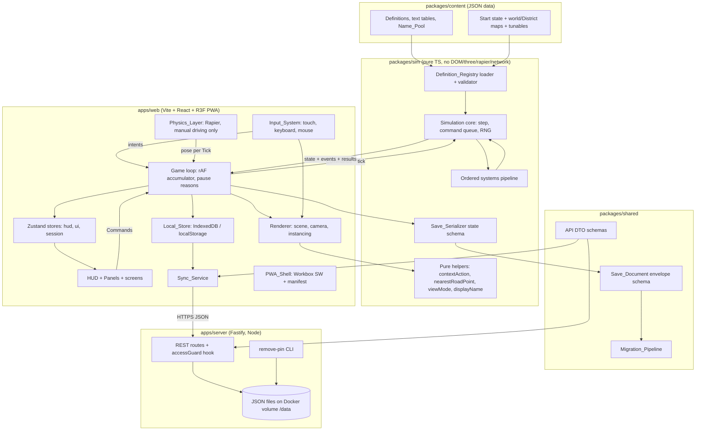
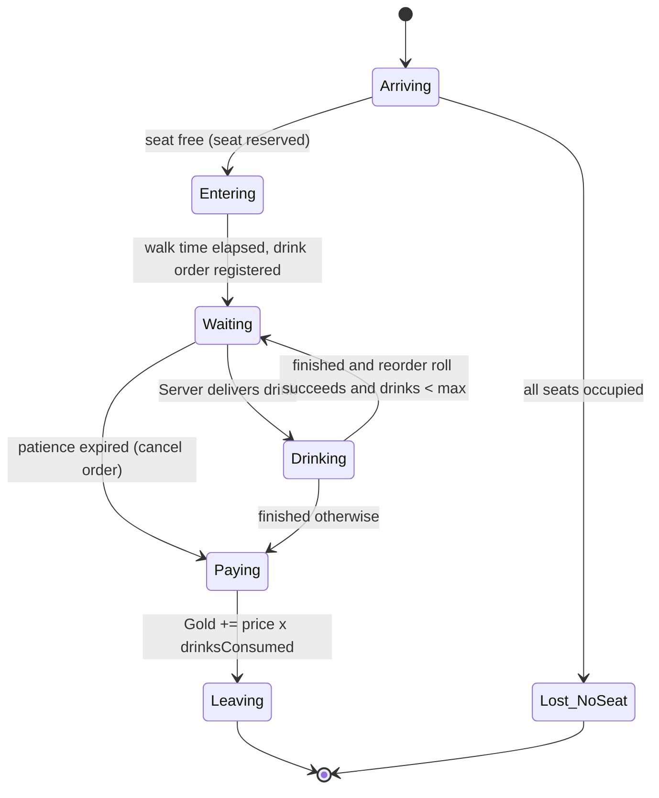
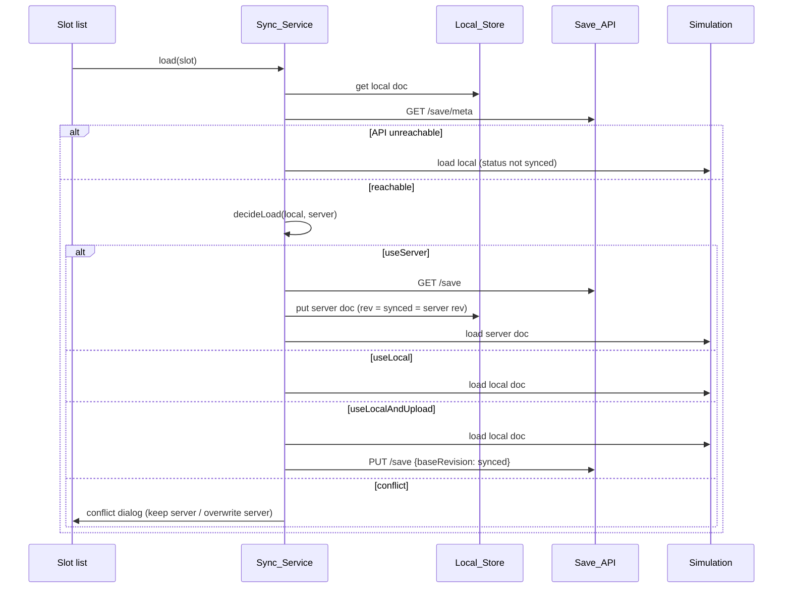

# Design Document: Human Resource MVP

## Overview

Human Resource is a TypeScript monorepo with four parts: a pure deterministic Simulation package, a data/content package, a shared save-format package, and two apps (a Vite + React + React Three Fiber PWA and a small Fastify Save_API). The Simulation owns all game rules and is the single source of truth. The web app runs the game loop, renders interpolated snapshots, converts input into Commands, and persists Save_Documents locally and to the server.

Design goals, in priority order:

1. **Determinism and testability.** All rules live in `packages/sim`, which cannot import DOM, three, Rapier, network or Node APIs. State is plain JSON data. Randomness comes only from a seeded PRNG stored in state. Every external influence (Player input, physics pose of a manually driven van, UI events that fire Reveal_Triggers) enters as a Command applied at a Tick boundary. This makes the determinism, round-trip and invariant properties directly testable in Node (Requirements 2, 24, 44).
2. **Data-driven content.** Businesses, Resources, Vehicles, Jobs, Humans, Recipes, Traits, Brands, Achievements, Reveal_Triggers, text tables, the Name_Pool, start state, map and tunables are JSON data validated by zod schemas plus a referential-integrity pass at startup (Requirement 1). Formulas (demand, staffing, reputation modifier) are parameterised formula kinds, never evaluated strings.
3. **Phase 2 is additive.** Phase 2 adds Definitions, optional state sections and systems in reserved pipeline slots. Phase 1 code paths are already generic (Resource lots with recipe id, generic production rules, Sourcing_Policy defaulting to "buy externally", Owner on every entity, Reputation present at 50). A schema migration adds the Phase 2 state sections to existing saves.
4. **Phone-first performance.** Instanced placeholder primitives, aggregated indicators at far zoom, adaptive DPR, a sub-4 ms Tick budget, and lazy loading of the physics chunk.

Key decisions and rationale:

| Decision | Rationale |
|---|---|
| Simulation runs on the main thread in Phase 1 | Tick budget is small (≤4 ms at 10 Hz), and manual driving needs tight coupling with the render loop. Commands and snapshots are serialisable, so moving the Simulation into a Web Worker later is a contained change. |
| Systems mutate a working state in place; `step()` is deterministic | Cloning the full state every Tick would waste the phone budget. Systems are deterministic functions of (state, commands, definitions) with no I/O. Tests use `stepPure()`, which clones first. |
| Entity tables are `Record<Id, T>` with prefixed string ids (`biz_0001`) | Non-integer string keys keep insertion order in JS objects and through `JSON.parse`, so iteration order is deterministic and survives save round-trips. |
| No transcendental math in the Simulation | Only `+ - * /`, `Math.sqrt`, `Math.floor/ceil/round/min/max/abs` are used (correctly rounded under IEEE 754). Demand uses piecewise-linear tables instead of `pow`/`exp`. Determinism therefore also holds across browsers, not just within one runtime. |
| PBKDF2-SHA256 for PIN hashes | Available in both `node:crypto` and browser WebCrypto, so the client can verify a PIN offline against the cached salted hash (Requirement 22.7). scrypt/argon2 are not in WebCrypto. |
| JSON files on a Docker volume for the Save_API | Two users, tiny write rate. Atomic write-then-rename per file avoids native build dependencies (better-sqlite3) in the image. The storage layer sits behind an interface, so SQLite can replace it later. |
| No multiplayer, ever planned | Each device runs its own Simulation; the Save_API only stores Profiles and Save_Documents. No shared cities, no server-side simulation, no real-time sync between players. "Shared city / multiplayer" lives only in `docs/wishlist.md`. This keeps the server rule-free and the Simulation single-writer. |
| Game_Speed lives in the web session layer | The Simulation only counts Ticks, so 1x/2x/4x is purely a loop concern (`acc += dt × speed`, cap `10 × speed` Ticks per frame). Speed is not in `SimState` or the Save_Document; loads start at 1x (Requirement 47). Manual_Driving forces 1x because Rapier steps in real time. |
| Districts from day one | The map is a set of District files plus a world file of District_Connectors. Path-finding runs over the union of unlocked Districts; paths are derived data cached per unlocked set, recomputed on unlock and on load, never saved. Expansion becomes a data and state change (Requirement 48). |
| Job_Slot fill is a tagged union | `filledBy: null \| {kind:'human', humanId} \| {kind:'headcount', count, humanDefId}`. Phase 1 only creates `human` fills, but every system reads capacity through one helper, so the later "people become numbers" automation needs no system rewrite (Requirement 49). |
| Fixed camera angle | Overcooked-like fixed yaw, no rotation input at any band. Input directions map to fixed screen-aligned world axes, which keeps controls, labels and Panels simple on touch (criterion 15.12). |
| English-only text by key | Every user-facing string lives in `packages/content/data/text/en.json` and is looked up via `t(key, params)`; a test fails on keys used in code but missing from `en.json` (criterion 46.8). |
| HTTPS via `tailscale serve` | Service workers need a secure context. `tailscale serve` terminates TLS with a valid `*.ts.net` certificate and exposes the container only on the tailnet (Requirements 26.1, 43.3). |

Research notes that informed the design:

- OneDrive has no supported per-subfolder exclusion for personal accounts; Microsoft's answers state only file-type exclusion exists, and admin folder-name exclusion is a managed-policy feature ([Microsoft Q&A](https://learn.microsoft.com/en-us/answers/questions/3984238/how-to-exclude-a-folder-from-onedrive-syncing)). Files reached through a folder link inside the OneDrive folder are still synchronised ([Microsoft Support](https://support.microsoft.com/en-au/office/can-t-synchronize-onedrive-files-and-folders-from-a-local-file-location-other-than-the-default-onedrive-path-b7eef9d4-4203-431d-8345-fe49254f9da0)), so a junction from the project to an outside `node_modules` is not a reliable exclusion. The repository-hygiene section below reflects this. Content was rephrased for compliance with licensing restrictions.
- `@dimforge/rapier3d-compat` (used by `@react-three/rapier`) embeds its WASM in the JS bundle, so Workbox precaches it like any other chunk and manual driving works offline.
- `vite-plugin-pwa` with `registerType: 'prompt'` exposes an `onNeedRefresh` callback and an `updateSW()` function, which lets the Game save first and then activate the new service worker (Requirement 42.4).

## Architecture

### Layer diagram



### Dependency rules

| Package | May import | Must not import |
|---|---|---|
| `packages/sim` | `zod`, own modules | `react`, `three`, `@react-three/*`, `@dimforge/*`, `idb`, `zustand`, `node:*`, `fetch`, DOM globals, `Date`, `Math.random`, `performance` |
| `packages/content` | nothing (data only) | everything |
| `packages/shared` | `zod` | `packages/sim` internals, DOM, Node |
| `apps/web` | everything above, React stack | `apps/server` |
| `apps/server` | `packages/shared`, Fastify, `node:*` | `packages/sim`, `apps/web` |

Enforcement (Requirement 2.4):

- `packages/sim/tsconfig.json` uses `"lib": ["ES2022"]` and `"types": []`, so DOM and Node globals do not type-check.
- ESLint flat config for `packages/sim/**` sets `no-restricted-imports` (patterns above), `no-restricted-globals` (`window`, `document`, `navigator`, `fetch`, `performance`, `setTimeout`, `setInterval`), and `no-restricted-properties` for `Math.random`, `Date.now` and `Math.pow/exp/log/sin/cos/tan/atan2/hypot`.
- A Vitest test imports the sim entry point under the `node` environment with no DOM shims (Requirement 44.3).

The server does not validate the full Simulation state. It validates the Save_Document envelope (schema version, revisions, ids, size), which keeps the server independent of game rules.

### Runtime data flow per frame

```mermaid
sequenceDiagram
  participant RAF as requestAnimationFrame
  participant Loop as GameLoop
  participant Phys as Physics_Layer
  participant Sim as Simulation
  participant Store as Zustand stores
  participant R3F as Renderer

  RAF->>Loop: frame(now)
  Loop->>Loop: if pauseReasons empty: acc += dt × speed
  Loop->>Loop: n = min(floor(acc/100), 10 × speed); drop backlog if more
  loop n Ticks
    Loop->>Phys: read latest manual pose (if driving)
    Loop->>Sim: enqueue manualVehicleUpdate + queued UI Commands
    Sim->>Sim: step(): pipeline of systems
    Sim-->>Loop: results + domain events
    Loop->>Loop: prevSnapshot = currSnapshot; currSnapshot = state
  end
  Loop->>Store: publish HUD fields, results, events (throttled panels)
  Loop->>R3F: alpha = acc / 100 for interpolation
  R3F->>R3F: useFrame: interpolate poses, update instance matrices
  Phys->>Phys: Rapier step (paused when Ticks stopped)
```

## Components and Interfaces

### Repository and folder layout

```
HumanResource/                       (git: main, remote github.com/davidzonnenberg/HumanResource.git)
  package.json                       npm workspaces: packages/*, apps/*
  package-lock.json                  committed (Requirement 45.3)
  tsconfig.base.json                 strict, noUncheckedIndexedAccess, exactOptionalPropertyTypes
  eslint.config.js                   per-package restriction blocks
  vitest.workspace.ts                projects: sim, shared, web, server
  .gitignore  .gitattributes (* text=auto eol=lf)  .editorconfig
  README.md
  .github/workflows/ci.yml           npm ci, typecheck, lint, test, build on push and PR (Node 24)
  .kiro/steering/architecture.md     architecture rules for later tasks (dependency rules, determinism, text keys)
  docs/
    deployment.md                    Docker, tailscale serve, PIN removal CLI, security note
    onedrive.md                      OneDrive handling
    content-authoring.md             how to add Definitions / names / text / Districts
    wishlist.md                      far-future ideas, not specified (time of day, multiplayer, ...)
  packages/
    content/
      data/
        resources.json  businesses.json  vehicles.json  jobs.json  humans.json
        traits.json  recipes.json  brands.json  achievements.json  reveal-triggers.json
        text/en.json                 ALL user-facing strings by Text_Key (UI labels, business names, alerts, news, legal-status lines)
        name-pool.json               Human first names
        start-state.json             start Pub, Humans (Jan/Julia/Thomas), stock %, Gold, orders, District states
        maps/world.json              District list (file, unlock condition) + District_Connectors
        maps/districts/*.json        per District: bounds, road sub-graph, plots, unloading zones, drivable/walkable bounds
        config/sim.json              tunables (tick ms, thresholds, factors)
        config/camera.json           zoom bands, threshold, hysteresis, tilt, fov
        config/theme.json            palette, vehicle/crate scales
        phase2/                      Phase 2 definitions (additive pack)
      index.ts                       typed re-export of raw JSON
    sim/
      src/
        index.ts                     public API
        core/        simulation.ts step.ts commandQueue.ts pipeline.ts ids.ts
        rng/         xoshiro128ss.ts
        money/       gold.ts (hundredths helpers, mulDivFloor, applyGold)
        defs/        schemas.ts registry.ts validateRefs.ts formulas.ts
        state/       types.ts schema.ts (zod for SimState) newGame.ts
        commands/    types.ts handlers/*.ts reasons.ts
        systems/     scheduler.ts humans.ts production.ts customers.ts staff.ts
                     logistics.ts sourcing.ts finance.ts metrics.ts alerts.ts reveals.ts
                     phase2/ market.ts acquisitions.ts competitors.ts questionable.ts
                             chains.ts reputation.ts minigames.ts achievements.ts
        logistics/   roadGraph.ts paths.ts pathCache.ts (per unlocked District set) nearestRoadPoint.ts
        staffing/    capacity.ts (working capacity of a Job_Slot: human or headcount)
        storage/     stock.ts (lots, FIFO, capacity)
        names/       drawName.ts displayName.ts
        conditions/  evaluate.ts (Reveal_Trigger / Achievement condition DSL)
        interaction/ contextAction.ts viewMode.ts
        invariants/  check.ts (used by tests and dev builds)
      test/          unit + property tests, arbitraries/
    shared/
      src/  saveDocument.ts  migrations/index.ts migrations/v1_to_v2.ts ...
            api.ts (DTO zod schemas)  validation.ts (names, PIN format)  pinHash.ts (PBKDF2 params)
      test/fixtures/v1/*.json ...
  apps/
    web/
      vite.config.ts                 cacheDir from env, vite-plugin-pwa
      index.html
      public/icons/
      src/
        main.tsx  app/App.tsx  app/routes.tsx
        loop/        GameLoop.ts pauseReasons.ts tickBudget.ts gameSpeed.ts
        dev/         devMode.ts (?dev=1, dev build, Pause_Menu "Testing" toggle)
        text/        t.ts (typed Text_Key lookup over content en.json)
        store/       hudStore.ts uiStore.ts sessionStore.ts simBridge.ts
        render/      Scene.tsx CameraController.tsx World/* Instanced/* assets/modelMap.ts
                     interpolation.ts aggregation.ts AdaptiveDpr.tsx labels/*
        physics/     ManualDriving.tsx VehicleBody.tsx uprightMonitor.ts colliders.ts
        input/       InputSystem.ts Joystick.tsx ContextButton.tsx keyboard.ts gestures.ts
        ui/          hud/* panels/* screens/* components/Card.tsx
        persistence/ localStore.ts idbStore.ts lsStore.ts autosave.ts
        sync/        syncService.ts loadDecision.ts apiClient.ts deletionQueue.ts
        pwa/         registerSW.ts UpdatePrompt.tsx
    server/
      src/  index.ts app.ts routes/{health,profiles,slots,saves}.ts
            storage/{fileStore.ts,atomicWrite.ts,locks.ts}
            auth/accessGuard.ts pin/{hash.ts,lockout.ts}  cli.ts
  Dockerfile
  docker-compose.yml
```

### Simulation core

Public API of `packages/sim`:

```ts
export interface SimulationInit {
  registry: DefinitionRegistry;     // validated, frozen
  state: SimState;                  // from newGame() or a loaded Save_Document
}

export interface TickOutput {
  results: CommandResult[];          // one per Command applied this Tick
  events: DomainEvent[];             // for UI, News_Feed, toasts, renderer effects
}

export class Simulation {
  constructor(init: SimulationInit);
  get state(): Readonly<SimState>;
  submit(cmd: Command, issuer: Issuer): number;   // returns seq; applied at next Tick boundary
  tick(): TickOutput;                               // advances exactly one Tick
}

export function newGame(registry: DefinitionRegistry, seed: number): SimState;
export function stepPure(registry: DefinitionRegistry, state: SimState,
                         cmds: CommandEnvelope[]): { state: SimState } & TickOutput;
export function loadRegistry(raw: RawContent): Result<DefinitionRegistry, DefinitionError[]>;
export function displayName(human: Pick<Human, 'name'>): string;
export function contextActionFor(view: InteractionView, reg: DefinitionRegistry): ContextAction | null;
export function nextViewMode(mode: ViewMode, distance: number, cam: CameraConfig): ViewMode;
export function nearestRoadPoint(graph: RoadGraph, x: number, z: number): RoadPoint;
export function pathCacheFor(reg: DefinitionRegistry, unlocked: readonly DistrictId[]): PathCache; // memoised, derived data
export function slotCapacity(slot: JobSlot, state: SimState): number;   // working capacity, human or headcount
```

- The `Simulation` instance holds the `PathCache` for the current unlocked District set. It is derived from (registry, `state.districts`) only, so it is rebuilt on load and after an unlock and is never serialised; `stepPure` memoises it by the sorted unlocked-id key. Determinism is unaffected.

- The seed is generated outside the Simulation (`crypto.getRandomValues` in the web app) and passed to `newGame`, which stores it in `state.seed` and initialises `state.rng` (Requirement 3.2).
- `submit` appends to an in-memory queue. `tick()` drains the queue in submission order at the start of the Tick (Requirement 2.7). The queue is not part of the saved state; on save the loop writes only after a Tick boundary, so the queue is empty.
- `tick()` returns rejected Commands with a `ReasonCode` and leaves state unchanged for that Command (Requirement 2.8). Handlers validate fully before mutating.
- RNG: xoshiro128** with 4 × uint32 state in `state.rng`. Helpers `rngNext`, `rngInt(lo, hi)`, `rngChance(p)`, `rngPick(array)` take the state and mutate `state.rng` only.

### Tick pipeline

Systems are entries in an ordered array. Each entry has an id, the phase it belongs to and a `run(ctx)` function. A system that depends on an optional Phase 2 state section returns early when the section is absent. Phase 2 entries already have reserved positions, so adding them does not reorder Phase 1 systems.

```ts
interface TickContext {
  state: SimState;
  reg: DefinitionRegistry;
  events: DomainEvent[];      // append-only for this Tick
  ledger: ResourceLedgerTick; // created/removed quantities per Resource and cause
}
interface SystemEntry { id: SystemId; phase: 1 | 2; run(ctx: TickContext): void; }
```

| # | System | Phase | Responsibility | Requirements |
|---|---|---|---|---|
| 0 | `clock` | 1 | `tick += 1`; derive game second | 2.1 |
| 1 | `commands` | 1 | Drain queue; validate and apply each Command; emit results | 2.7, 2.8, 6.8, 7.x, 10.3–10.5, 12.1–12.3, 13.x |
| 2 | `scheduler` | 1 | Fire due `ScheduledEvent`s in (fireTick, seq) order: construction done, hidden reveals, Consequences, QO completion | 27.3, 32.6, 37.4–37.6 |
| 3 | `competitorEvents` | 2 | Roll Competitor event table | 38 |
| 4 | `market` | 2 | Bounded random-walk price update at interval | 30.2, 30.3 |
| 5 | `acquisitions` | 2 | Generate and expire Acquisition_Offers | 32.1, 32.2 |
| 6 | `humans` | 1 | Walking along paths, arrival → start Job, boarding Vehicles | 7.4–7.9, 7.15, 13.12 |
| 7 | `production` | 1 | Generic production rules (Phase 1 has none active; Brewery in Phase 2) | 9.3, 29.1, 29.2 |
| 8 | `customerArrivals` | 1 | Arrival rate → spawn, seat or lose (no_seat); patience checks | 4.1, 4.3, 4.8–4.10 |
| 9 | `staff` | 1 | Bartenders pour (FIFO lot), Servers carry drinks | 4.6, 5.1–5.5, 34.3 |
| 10 | `customerVisits` | 1 | Drinking, reorder roll, pay, leave | 4.4, 4.5, 4.7, 34.4, 34.5 |
| 11 | `minigames` | 2 | Apply active temporary boosts / expire | 39.2 |
| 12 | `logistics` | 1 | Automatic Vehicles move along graph paths, arrive, load/unload, wait; manual pose already applied in step 1 | 11.x, 12.4–12.8, 7.12 |
| 13 | `sourcing` | 1 | Auto-reorder (Phase 1); Sourcing_Policy shortfall sizing (Phase 2) | 10.8–10.10, 10.12, 31.2 |
| 14 | `questionable` | 2 | Offer refresh; occupied timers handled via scheduler | 37 |
| 15 | `finance` | 1 | Salaries per Tick with exact carry, rentals; Mandatory_Expenses | 7.3, 8.5, 28.4 |
| 16 | `chains` | 2 | Corporate_Chain detection and Synergy generation | 35 |
| 17 | `reputation` | 2 | Clamp, demand modifier refresh, news | 36 |
| 18 | `metrics` | 1 | Rolling windows: Pub metrics, Vehicle deliveries, Route flows, recommended staff, popularity band, Brewery unit cost | 6.1–6.3, 11.6–11.9, 17.4, 29.4 |
| 19 | `alerts` | 1 | Derive Alert set from conditions and previous Alert set | 4.11, 4.12, 5.6, 6.5, 6.6, 9.8, 9.9, 10.7, 10.10, 12.5, 31.3 |
| 20 | `reveals` | 1 | Evaluate Reveal_Trigger conditions over this Tick's events and state; record first firing | 19.1, 19.4–19.6 |
| 21 | `achievements` | 2 | Evaluate Achievement conditions; award once | 40.2 |

Ordering rationale: Commands first so Player changes apply from this Tick (price change "from the next Tick" holds because the Command is applied at the boundary before any payment). Consumption (8–10) runs before logistics and sourcing, so auto-reorder sees post-consumption stock and post-delivery Pending_Quantity. Finance runs after operations so Salary is charged every Tick regardless of what happened. Metrics, Alerts and Reveals run last because they observe the final state of the Tick.

### Commands

```ts
type Issuer = 'player' | 'physics' | 'ui' | 'system';
interface CommandEnvelope { seq: number; issuer: Issuer; cmd: Command; }

type Command =
  // Human allocation (Req 7)
  | { type: 'hire' }
  | { type: 'assign'; humanId: Id; target: JobSlotRef }
  | { type: 'fire'; humanId: Id }
  // Pub (Req 6, 10)
  | { type: 'setDrinkPrice'; businessId: Id; price: Gold }
  | { type: 'placeOrder'; supplierId: Id; destinationId: Id; resourceId: ResourceId; quantity: number }
  | { type: 'setAutoReorder'; businessId: Id; resourceId: ResourceId; enabled: boolean; threshold: number }
  // Routes and vehicles (Req 12, 13)
  | { type: 'setRoute'; vehicleId: Id; stops: RouteStopInput[]; waitSeconds?: number }
  | { type: 'resumeRoute'; vehicleId: Id }
  | { type: 'startManualDriving'; vehicleId: Id }
  | { type: 'manualVehicleUpdate'; vehicleId: Id; x: number; z: number; heading: number; speed: number }
  | { type: 'manualLoad'; vehicleId: Id; businessId: Id }
  | { type: 'manualUnload'; vehicleId: Id; businessId: Id }
  | { type: 'endManualDriving'; vehicleId: Id }
  | { type: 'resetVehicle'; vehicleId: Id; x: number; z: number; heading: number } // upright reset onto road point
  // CEO (Req 14, 15)
  | { type: 'ceoMove'; dx: number; dz: number }   // normalised intent, |d| <= 1, applied for one Tick
  | { type: 'ceoEnter'; businessId: Id }
  | { type: 'ceoExit' }
  | { type: 'uiEvent'; event: 'managementViewOpened' | 'panelOpened'; target?: Id }
  // Districts (Req 48): issuer 'system' only; no Player UI in Phase 1, used by tests and later expansion
  | { type: 'unlockDistrict'; districtId: DistrictId }
  // Phase 2 (additive)
  | { type: 'buyPlot'; plotId: Id }
  | { type: 'construct'; plotId: Id; businessDefId: DefId }
  | { type: 'acquireWarehouse'; plotId: Id; mode: 'buy' | 'rent' }
  | { type: 'endRental'; businessId: Id }
  | { type: 'setSourcingPolicy'; businessId: Id; resourceId: ResourceId; policy: SourcingPolicy }
  | { type: 'marketBuy'; resourceId: ResourceId; quantity: number }
  | { type: 'acceptAcquisition'; offerId: Id }
  | { type: 'setProductionRecipe'; businessId: Id; recipeId: RecipeId }
  | { type: 'startQuestionable'; opportunityId: Id; humanIds: Id[]; destinationId: Id }
  | { type: 'completeMinigame'; minigameId: DefId; businessId: Id; score: number };

type ReasonCode =
  | 'insufficient_gold' | 'invalid_price' | 'invalid_quantity' | 'invalid_threshold'
  | 'invalid_route' | 'not_owner' | 'slot_occupied' | 'human_occupied' | 'unknown_entity'
  | 'not_in_range' | 'not_stopped' | 'vehicle_not_manual' | 'storage_not_empty'
  | 'insufficient_humans' | 'nothing_to_load' | 'nothing_to_unload' | 'offer_expired'
  | 'district_locked';

type CommandResult =
  | { seq: number; ok: true }
  | { seq: number; ok: false; reason: ReasonCode; missingGold?: Gold; field?: string };
```

Notes:

- `assign` to a Job_Slot occupied by a Human is valid and displaces the occupant (7.7); `slot_occupied` is returned when the slot holds a Headcount_Fill (49.6) and for Phase 2 cases such as an occupied Plot.
- `assign`, `setRoute` and `placeOrder` targeting a Business in a locked District are rejected with `district_locked` (48.7).
- `insufficient_gold` always carries `missingGold = cost − gold` (7.2, 8.4, 10.5, 32.5).
- `manualVehicleUpdate` is submitted by the Physics_Layer once per Tick (2.9). The Simulation clamps the reported position to the drivable bounds and stores it; it does not trust speed for anything except the "stopped" check (< 0.5 World_Units/s).
- `manualLoad`/`manualUnload` are valid only if the Vehicle is under Manual_Driving, its last reported speed is below 0.5 and its position is inside the Business's Unloading_Zone (13.6–13.8).

### Simulation systems in detail

#### Money (Requirement 8)

- `Gold` is an integer in hundredths. All arithmetic uses integer helpers: `mulDivFloor(a, num, den)`, `percentOf(amount, basisPoints)`. Rounding rule: costs round up (`ceil`) so the Player never pays less than the defined cost; rewards and tips round down.
- Every change goes through `applyGold(state, owner, delta, category, source)`. For Competitor owners it is a no-op (8.9). For the Player it updates `player.gold` and adds `delta` to the finance ring buffer bucket for the current game second under `category|source`.
- Discretionary handlers call `requireGold(cost)` before mutating; Mandatory_Expenses call `applyGold` unconditionally (8.5).
- Salary per Tick: each Human keeps `salaryCarry` (in hundredths × ticksPerMinute units). Per Tick: `carry += salaryPerMinute; charge = floor(carry / ticksPerMinute); carry -= charge * ticksPerMinute`. Over every 600 Ticks the charged total equals the Salary exactly (7.3).
- Hiring_Cost = `ceil(salaryPerMinute × hiringMinutes × hiringFactor)` from the Human Definition (defaults 60, 0.05).
- Finance Panel (8.3) sums the last 300 game-second buckets per category.
- Safe-integer headroom (8.10): `GOLD_LIMIT = 2 ** 50` hundredths (as a literal constant, not `Math.pow`). `invariants/check.ts` scans every Gold field (player gold, prices, finance buckets, carries, Orders, offers) and reports `gold_limit_exceeded` with the field path when `|value| > GOLD_LIMIT`. Dev and test builds throw like any invariant failure; production logs a developer warning and keeps running (not a `fatalError`). 2^50 leaves 3 bits below `Number.MAX_SAFE_INTEGER` (2^53 − 1), so sums of a few values and `mulDivFloor` intermediates stay exact.

#### Storage and lots (Requirements 9, 34.2, 34.3)

```ts
interface Stock { amount: number; lots: Lot[] }   // invariant: amount === sum(lots.qty)
interface Lot { qty: number; recipeId: RecipeId | null; arrivedTick: Tick; origin: LotOrigin }
type LotOrigin = 'start' | 'supplier' | 'market_depot' | 'brewery' | 'business' | 'reward';
```

- `freeCapacity(stock, cap) = max(0, cap − amount)`. All inflows use `addToStock(stock, lot, cap)` which accepts `min(lot.qty, freeCapacity)` and returns the remainder. This one function enforces 9.4, 9.5 (over capacity accepts nothing) and the storage invariant 2.10.
- Outflows `takeFromStock(stock, qty)` take FIFO by `arrivedTick` and return the taken lots, so Recipe identity and origin travel with cargo.
- Shared capacity across Recipes (34.2) follows naturally: capacity is per Resource and lots share it.
- When loading a Vehicle, taken lots get `origin` set to the pickup kind (`supplier`, `market_depot`, `brewery`, or `business` for any other Business). The Manual_Delivery_Tip (13.9) counts only unloaded lots whose origin is `supplier`, `market_depot` or `brewery`.

#### Supplier and Orders (Requirement 10)

- The Supplier is a Business with `type: 'supplier'`, owner `npc` and unlimited stock (no Storage record). An `Order` reserves `quantity` of a Resource for a named destination. Placing an Order creates the quantity in the world (recorded in the resource ledger as `order_placed`).
- At a Supplier pickup stop, a Vehicle loads from open Orders of its Owner whose destination is the Route's next drop-off stop, oldest first, as lots with origin `supplier`.
- `pendingQuantity(dest, res)` = Σ open Order remaining for `dest` + Σ cargo of the Owner's Vehicles whose next drop-off stop is `dest`.
- Auto-reorder (10.8–10.10): if `amount + pending < threshold`: `want = cap − amount − pending`; `affordable = floor(gold / unitPrice)`; `qty = min(want, affordable)`. If `want > 0` and `qty == 0`, raise `reorder_failed` and retry next Tick. Because `qty ≤ want`, `amount + pending + qty ≤ cap` (10.12). If `amount > cap` (over capacity), `want ≤ 0` and nothing is ordered.
- Competitor auto-reorder uses the same code; for Competitor owners `affordable` is unbounded and `applyGold` is a no-op, so they never fail on Gold (8.9).

#### Customers and staff (Requirements 4, 5, 6)

Customer state machine (rendering positions are derived from the Business layout anchors and the state's progress; the Simulation does not track Customer coordinates):



- Arrival: `rate = demand(pubDef, price, reputation, brandMods)` in Customers per Game_Minute. Each Tick, `arrivalAcc += rate`; while `arrivalAcc ≥ ticksPerMinute`, spawn one Customer with a small seeded jitter on entry delay. `demand` = `baseDemand × priceMultiplier(price) × reputationMultiplier(rep) × brandMultiplier`. `priceMultiplier` is a piecewise-linear table of (price, multiplier) points; the registry rejects tables whose multipliers increase with price, so the arrival rate is monotonically non-increasing in price (4.2).
- Seat taken → register drink order (4.4). Order queue per Pub is FIFO by registration Tick.
- Bartender: if the order queue has an unpoured order and stock ≥ 1, start a pour task; when it completes after `bartendingInterval`, take 1 Beer (FIFO lot, recorded as `consumed` in the ledger) and put a poured drink on the bar (4.6, 5.1, 5.2). Beer is removed at pour time. No Bartender → no pours (5.4).
- Server: takes the oldest poured drink, carry duration = layout distance bar→seat ÷ Job movement speed, delivers (5.3). No Server → drinks stay on the bar (5.5).
- Patience: if `tick − orderTick > patience × ticksPerSecond` for an undelivered order, the order is cancelled. A poured-but-undelivered drink for that order is discarded (it was already removed at pour time, consistent with the ledger). Customer pays for drinks consumed and leaves; if none, Lost_Customer with reason `out_of_beer` when stock is 0 at that moment, else `patience_expired` (4.8, 4.9).
- Reorder: on finishing a drink with `drinks < maxDrinksPerVisit`, roll `rngChance(clamp(effectiveRepeat, 0, 0.9))` (4.5, 34.5). Effective repeat chance = Pub base + Recipe Trait modifiers of the drink's lot.
- Pay: `applyGold(owner, price_at_payment_tick × drinksConsumed, 'sales', pubId)` (4.7).

Staffing recommendation (6.3) uses the formula kind `throughput` from data: `ceil(arrivalsPerMin × expectedDrinksPerVisit × bartendingIntervalSec / 60 × (1 + serverRatio) × headroom)`.

#### Humans and allocation (Requirement 7)

- A Job_Slot's `filledBy` is `null`, `{kind: 'human', humanId}` or `{kind: 'headcount', count, humanDefId}`; a Human references at most one Job_Slot. For human fills both sides are updated together in one handler, and the invariant checker verifies the bidirectional link.
- Headcount_Fill (49): systems never read `filledBy` directly; they call `staffing/capacity.ts`. `slotCapacity(slot)` returns 1 for a human fill whose Human is `working` at the Job location, `count` for a headcount fill, 0 otherwise. The `staff` system keeps one task cursor per capacity unit for headcount fills (`slot.headcountTasks: (StaffTask | null)[]`, length = count), so N headcount Bartenders pour independently exactly like N working Humans. A Driver headcount fill makes `driverOnBoard` true. `finance` charges `count × salaryPerMinute(humanDefId)` per Game_Minute with a per-slot `headcountSalaryCarry` using the same exact-carry rule as Humans. `metrics` and `alerts` sum `slotCapacity`. The renderer draws no figures for headcount fills. `count` is validated against `JobDef.maxHeadcountPerSlot` (default 1) by the state schema. Phase 1 has no Command or content that creates a headcount fill (49.7); tests construct such states directly.
- `assign`: if the Human is assigned elsewhere, clear that slot (at this Tick boundary, 7.8); if the target slot is occupied, set the occupant unassigned at its current position (7.7); set status `en_route`; compute a walking path from the Human's current position (mid-path positions are valid starting points, 7.9) along the road graph to the target location.
- On arrival: status `working` (7.6). For a Driver slot, arrival at the Vehicle sets `driverOnBoard = true`.
- `fire`: reject with `human_occupied` if status is `occupied` (7.13); otherwise remove, apply Severance as Mandatory_Expense (7.11). Firing or reassigning a driving Human stops the Vehicle where it is, keeping cargo and Route (7.12).
- Hiring adds an unassigned Human at the Player's first Pub with a name from `drawHumanName` (7.1, 7.19).
- Qualifications are a string set from the Human Definition (Phase 1/2: `["regular"]`); Job Definitions list required qualifications (7.10, 46.2, 46.3).

Name drawing (7.18–7.22):

```ts
function drawHumanName(state: SimState, pool: readonly string[], forWorkforce: boolean): string {
  const used = forWorkforce ? baseNamesInWorkforce(state) : new Set<string>();
  const unused = pool.filter(n => !used.has(n));
  const base = rngPick(state, unused.length > 0 ? unused : pool);
  return forWorkforce ? uniqueInWorkforce(state, base) : base;
}
// uniqueInWorkforce: if base is free return base; else lowest k >= 2 with `${base} ${k}` free.
```

Acquired employees keep their name unless it collides, in which case `uniqueInWorkforce` appends a suffix (7.21). `displayName(human)` in `names/displayName.ts` returns `human.name` and is the only function the UI uses for Human labels (46.7).

#### Logistics (Requirements 11, 12, 13)

- Districts (48): `maps/world.json` lists Districts (`id`, `file`, `unlockCondition`) and District_Connectors (`{id, a: {district, node}, b: {district, node}}`); each `maps/districts/<id>.json` holds that District's bounds polygon, nodes, edges, Plots, Unloading_Zones and drivable/walkable bounds. Node ids are namespaced `<districtId>:<nodeId>` at load, Plot ids are globally unique. `state.districts` stores `{ unlocked: boolean }` per District.
- Road graph: `nodes {id, x, z}`, `edges {id, a, b, length}` per District, plus one connector edge per District_Connector. At registry load, lengths are computed with `Math.sqrt`. The routable graph is the union of unlocked Districts' sub-graphs plus connectors whose two Districts are unlocked; `pathCacheFor(reg, unlocked)` precomputes all-pairs shortest paths on that union (Floyd–Warshall while the union stays under ~500 nodes; above that, per-source Dijkstra on demand with deterministic tie-breaking by node id). The cache is recomputed by the `unlockDistrict` handler before the `humans` and `logistics` systems run in the same Tick, and on load (48.5, 48.6). Each Plot has an `accessNode` and an `unloadingZone` rectangle.
- Locked Districts: drivable and walkable bounds are the union of unlocked Districts' bounds, so CEO movement clamps there and manual driving into a locked District triggers the out-of-bounds reset (48.8, 13.15). `contextActionFor` ignores interactables in locked Districts (48.9).
- `PathCursor { nodes: NodeId[]; seg: number; along: number }`. Each Tick an automatic Vehicle advances `speed × tickSeconds` along its path, so travel time equals road distance ÷ speed (11.5).
- Route stop cycle: `driving → arrive → loading/unloading (duration = amount ÷ loadRate) → (waiting if load 0, then reload once) → next stop`. Load amount at pickup = `min(available reserved/owned stock, free cargo capacity, next drop-off free Storage)` (12.6). At drop-off, unload via `addToStock` and keep the remainder on board (12.8, 9.4).
- A Vehicle with `driverRequirement` and no Driver on board, not manual, does not move (11.4). With a Driver and no Route it parks and raises `no_route` (12.5).
- Routes are stop lists independent of path-finding; a `pathProvider` function computes paths, so traffic-aware routing can replace it later (46.5).
- Manual driving: `startManualDriving` sets `control = 'manual'`, suspends the Route if it was automatic, and leaves the displaced Driver assigned, off board, idle at the takeover position (13.10). Each Tick the Physics_Layer's `manualVehicleUpdate` sets the pose. `endManualDriving` sets `control = 'parked'`; the UI then asks about resuming (13.11). `resumeRoute` sends the Driver walking to the Vehicle; when the Driver boards, the Vehicle snaps to `nearestRoadPoint`, and the next stop becomes the Route stop with the smallest road distance from that point (13.12).
- Cargo is Simulation data only. Collisions are visual and physical in the render layer and never change cargo (13.5). Upright and out-of-bounds resets send `resetVehicle` with a `nearestRoadPoint` pose; cargo is untouched (13.14, 13.15).

#### Metrics (Requirements 6, 11, 17, 29)

Rolling windows are fixed-length ring buffers indexed by game second (`tick / ticksPerSecond`), stored in state so they survive saves:

- Pub (60 s window): arrivals, lost by reason, wait-time sum and count, working service Humans sampled per second. Lost % = lost ÷ arrivals × 100, or 0 when arrivals are 0 (6.2).
- Vehicle/Route (300 s window): deliveries, delivered and picked-up quantities per Resource. Business (300 s): consumed and produced per Resource. Bottleneck flags (11.7–11.9) compare these with the default 10% margin.
- Popularity band from arrivals per minute thresholds in data (17.4). Brewery effective unit cost (29.4) from input costs and Brewer Salaries over 300 s.

#### Alerts (Requirement 18.10 and the Alert criteria)

```ts
type AlertType = 'out_of_beer' | 'lost_customers' | `unstaffed:${JobId}` | `storage_full:${ResourceId}`
  | `storage_empty:${ResourceId}` | 'awaiting_pickup_no_route' | 'reorder_failed' | 'no_route'
  | 'no_internal_supply';
interface Alert { key: `${AlertType}@${Id}`; type: AlertType; objectId: Id; since: Tick; variant?: string }
```

- `state.alerts` is a `Record<key, Alert>`, so at most one Alert per type per object exists by construction (18.10).
- Each Tick the `alerts` system recomputes the set: `active' = raise(cond) || (active && !clear(cond))`. Most types have `clear = !raise`. `lost_customers` raises at lost% > 10 with ≥ 10 arrivals and clears only at lost% ≤ 10 (6.5, 6.6); its `variant` is the most frequent lost reason, which picks the text "Understaffed", "Out of seats" or "Out of Beer" from the text table.
- The stock-based `out_of_beer` Alert (4.11, 4.12) and the `lost_customers` variant `out_of_beer` would display the same text; the HUD merges them into one row for the Pub.
- Client-side Alerts (save failure 23.7, "Too large to sync" 25.12, "not synced") are kept in `hudStore`, not in the Simulation, and are merged in the HUD with the same one-per-type-per-object rule.

#### Reveal_Triggers and Achievements (Requirements 19, 40)

Conditions are a small declarative DSL validated by zod, never code strings:

```ts
type Condition =
  | { kind: 'event'; event: DomainEventType; where?: Record<string, string | number | boolean> }
  | { kind: 'goldAtLeast'; amount: Gold }
  | { kind: 'corporateResourceAtLeast'; resourceId: ResourceId; amount: number }
  | { kind: 'ownedBusinessCountAtLeast'; businessType: string; count: number }
  | { kind: 'all' | 'any'; of: Condition[] };
```

- Examples: `storage_responses` fires on `{event: 'storageFull', where: {owner: 'player'}}` (19.4); `hiring_option` on `{event: 'customerLost', where: {reason: 'patience_expired', owner: 'player'}}` (19.5); `first_management_view` on `{event: 'uiManagementViewOpened'}` (19.6). The renderer reacts to the `revealFired` event with the 10-second real-time highlight.
- `state.reveals.fired` is an ordered list of trigger ids and is part of the save (19.3). UI features check `isRevealed(featureKey)`. There are no levels or XP (19.2).
- The Pub Panel's "Add Human" response (6.7) is gated by the `hiring_option` reveal, so it appears only after the first patience-expired loss; "Change drink price" is always available.

#### Phase 2 systems (additive)

| System | State section added by migration | Notes |
|---|---|---|
| `market` | `market: { prices: Record<ResourceId, {buy, sell, history: number[]}>; nextUpdateTick }` | Random walk step drawn from RNG, then clamp `sell ∈ [min, max−spread]`, `buy = max(sell + minSpread, …)` clamped to max. Bounds validated `min > 0` at load (30.3). History keeps last 10 (30.6). |
| `acquisitions` | `acquisitions: { offers: Record<Id, AcquisitionOffer> }` | Hidden attributes stored with `hidden: true`; on accept, scheduler entries for reveals at per-attribute delays (32.6). Liability reveal applies cost via `applyGold(..., 'liability')`. |
| `competitorEvents` | `competitors[*].nextEventTick` | Weighted table from data; skip "open location" if no free Plot (38.2); price changes clamped to Pub bounds (38.3). |
| `questionable` | `questionable: { offers, running }` | Start removes Humans from Jobs and sets `occupied`; completion grants reward via `addToStock` (excess discarded, ledger records only the accepted part), then rolls Consequences into the scheduler (37.4, 37.5). |
| `chains` | `chains: { registered: Record<string, Chain> }` | Chain detection over a flow graph built from 300 s ledger of transfers (producer → vehicle → business). Synergy added to `player.corporateResources`. |
| `reputation` | already present in Phase 1 | Phase 1 has no system that changes it, so it stays at 50 (36.2). |
| `minigames`, `achievements` | `boosts`, `achievements` list | Boost ≤ 15% for ≤ 60 s enforced by schema bounds (39.2). |

Each Phase 2 Business type is a Definition (`brewery`, `warehouse`, `market_depot`) handled by the same storage, staffing, production and logistics code (1.8, 1.9, 46.1).

### Interaction helpers (pure, in `packages/sim/interaction`)

- `contextActionFor(view)` takes the CEO position, mode, inside-Business flag, manual Vehicle pose and speed, and the interactable list (Businesses' entrances, Vehicles, Plots, Supplier, Competitor Pub). It returns the action for the nearest object within `interactionRange` (default 2), or `null`: `Enter` for owned Businesses, `Inspect` for Competitor Pub, Competitor Vehicle, Supplier and Plots for sale, `Drive` for owned Vehicles, `Load`/`Unload` when driving, stopped (< 0.5) and inside an Unloading_Zone (`Unload` if the Business accepts part of the cargo, else `Load`), `Exit` when driving and stopped, `Help Serve` (Phase 2) when inside an owned Pub above the waiting threshold (13.1, 13.2, 13.6, 14.2, 14.3, 14.5, 39.1).
- `nextViewMode(mode, d, cam)`: `ceo → management` when `d > T`; `management → ceo` when `d < T × (1 − hysteresis)`; otherwise unchanged (15.3, 15.4).
- `nearestRoadPoint(graph, x, z)`: projection onto every edge segment, minimum distance.

### Game loop (`apps/web/src/loop/GameLoop.ts`)

```ts
type PauseReason = 'hidden' | 'pauseMenu' | 'speedPause' | 'syncConflict' | 'fatalError' | 'loading';
type GameSpeed = 1 | 2 | 4;
class GameLoop {
  pauseReasons: Set<PauseReason>;
  speed: GameSpeed = 1;                       // from sessionStore; not part of SimState
  private acc = 0; private last: number | null = null;
  frame(now: number) {
    if (this.pauseReasons.size > 0) { this.last = null; return this.render(this.acc / TICK_MS); }
    const dt = this.last === null ? 0 : now - this.last; this.last = now;
    const speed = this.effectiveSpeed();        // 1 while Manual_Driving (47.11)
    this.acc += dt * speed;
    const cap = BASE_MAX_TICKS_PER_FRAME * speed;   // 10 × speed (2.3)
    const due = Math.floor(this.acc / TICK_MS);
    const run = Math.min(due, cap);
    this.acc = due > cap ? this.acc % TICK_MS : this.acc - run * TICK_MS;
    for (let i = 0; i < run; i++) this.runTick();
    this.render(this.acc / TICK_MS);
  }
}
```

- `ticksToRun(acc, dt, speed)` is extracted as a pure function for testing (2.2, 2.3).
- Game_Speed (47): `loop/gameSpeed.ts` holds the pure rules: `availableSpeeds(revealed, devMode)` returns `[1]` until the `game_speed` Reveal_Trigger has fired or Dev_Mode is on, then `[1, 2, 4]`; `stepSpeed(current, dir, available)` for `[`/`]`; `effectiveSpeed(selected, manualDriving)` returns 1 while Manual_Driving. Speed is kept in `sessionStore`, reset to 1 on every new or loaded slot (47.3). The speed pause is the `speedPause` pause reason: setting it triggers a Local_Store write like the Pause_Menu; clearing it resumes only if no other reason remains (47.9, 47.10). Because the Simulation only sees Ticks, speed never affects state, saves or determinism (47.2). At 4x the Tick budget (≤ 4 ms) means ~16% of a real second on a phone for 40 Ticks; the per-frame cap of 40 bounds worst-case catch-up frames.
- Dev_Mode (`dev/devMode.ts`): on when `new URLSearchParams(location.search).get('dev') === '1'`, when `import.meta.env.DEV`, or when the Pause_Menu "Testing" toggle is on (stored in Local_Store `meta.devTesting`, per device). It only changes `availableSpeeds` (and shows the debug overlay of task 32.2); it never submits Commands or fires reveals (47.6).
- `last = null` while paused means no elapsed real time is simulated on resume (21.3, 21.5). Only `hidden`, `pauseMenu` and `syncConflict` are pause reasons for Requirement 21/25; the "resume route?" dialog does not pause (operations continue).
- `visibilitychange` → hidden adds `hidden` and triggers a Local_Store write after the current Tick (no Tick runs after the event because the loop checks reasons before the next Tick) (21.1, 21.2). Visible removes `hidden`; Ticks resume only if `pauseMenu` is not set (21.3, 21.4). `pagehide` triggers a write (23.2). Opening the Pause_Menu adds `pauseMenu` and writes (21.6, 21.7).
- Physics: `<Physics paused={pauseReasons.size > 0}>` (21.8).
- Snapshots: the loop keeps `prevPoses` and `currPoses` maps (id → x, z, heading) captured after each Tick for Humans, Vehicles and the CEO. The renderer lerps with `alpha`. Customers derive poses from state progress, which also interpolates with `alpha`.

### State bridge to React (`apps/web/src/store`)

- `hudStore` (Zustand): `gold`, `debt`, `alerts`, `contextAction`, `syncStatus`, `revealed` set, `newsTail`. Updated after each Tick batch; setters compare and skip unchanged values so React re-renders only on change.
- `uiStore`: `viewMode`, `cameraDistance`, `selection`, `openPanel`, `inputDevice` ('touch' | 'keyboard'), `pendingDialogs`.
- `sessionStore`: profile, slot, PIN lock info, migration/backup notices, `gameSpeed` (1 | 2 | 4), `speedPaused`, `devMode`.
- `simBridge`: holds the `Simulation` instance, exposes `useSimSelector(selector, equality)` for Panels. Panel subscriptions refresh at most 5 times per second of real time to avoid re-rendering at 10 Hz.
- R3F components never subscribe to state through React; they read `simBridge` and pose maps inside `useFrame` (transient updates).

### Renderer (`apps/web/src/render`)

- Scene: ground plane and road meshes merged into a few static geometries per material; Businesses as boxes (with removable roof and front-wall groups for interior view); Humans and Customers as capsules; Vehicles as box + four wheel cylinders; crates as small boxes. Owner colours and palette come from `theme.json` (20.1). Business names come from text tables via the registry (16.2).
- Asset mapping (16.4): `modelMap.ts` maps each `modelKey` to either `{ kind: 'primitive', shape, size, colorToken }` or `{ kind: 'gltf', url, scale, offset, rotation }`. A unit test asserts that every model key referenced in the registry has a mapping. Replacing a placeholder with a Kenney/KayKit glTF is a one-line mapping change; glTFs are loaded via drei `useGLTF` and precached by Workbox.
- Instancing: one `InstancedMesh` per (modelKey, material) for Humans, Customers and crates; matrices updated in `useFrame`. Businesses and Vehicles are few, so they are regular meshes until glTF swaps make instancing worthwhile.
- Interior (14.4): "Enter" sets `ceo.insideBusinessId`; the renderer hides that Business's roof and front walls and the camera eases to the Person band over the interior. No scene change or loading screen (15.1).
- Customers and staff animate between layout anchors (entrance, seats, bar, storage, exit) defined in the Business layout data (4.13, 5.7).
- Cargo crates: `crateCount = ceil(cargo / cratesPerUnit)` capped at a visual max, laid out on the vehicle bed (11.3). Storage indicators: stacked crates at 100%, empty shelf at 0 for Player-owned Businesses (9.6, 9.7).
- Name labels (7.24): drei `Text` (troika SDF) billboards above Humans, shown only in CEO_Mode at Person/Business bands, limited to the 12 nearest Humans in view, text from `displayName()`.
- Management overlays (15.8): Owner-coloured markers per Business, Vehicle and Plot; Route polylines; bottleneck Routes drawn in warning colour (11.7); Phase 2 chain highlight (35.4).
- Aggregation (15.11): when more than 20 Customer figures (default) would be visible, Customer instances are hidden and each Business shows an activity indicator (bubble with count, pulse rate from arrivals per minute). Visibility count uses Business bounding spheres against the camera frustum.
- Collision effect (20.3): on physics contact events above an impulse threshold, the van body mesh plays a squash-and-wobble spring and a small bounce; the cargo crate meshes jiggle.
- Districts (48.9): static geometry is built per District so an unlock adds a chunk without rebuilding others. Locked Districts render desaturated with a fence/"coming soon" marker at each District_Connector and are not selectable; Phase 1 ships the starting District plus, optionally, one visible locked neighbour.
- Headcount_Fill (49.8): no figures are drawn; a later phase may add an aggregated badge.

### Camera_Controller

- Perspective camera, fixed yaw (45°) and tilt starting at ~55° from horizontal, gently increasing toward ~70° at City band for readability; narrow FOV (~35°) for the Overcooked-like miniature look. All values in `camera.json`.
- No rotation, ever (15.12): there is no yaw input binding or gesture (two-finger twist is ignored), and the yaw is a constant, not state. Movement and pan input map to fixed screen-aligned world axes: screen-up is the ground projection of the camera forward vector, screen-right its perpendicular. Because the yaw never changes, these two axis vectors are computed once from `camera.json`.
- Bounds (48.10): Management_View pan clamps to the combined bounding box of unlocked Districts; the City band's maximum distance is computed so that box fits the viewport at the current aspect ratio (capped by `dMax` from `camera.json`), and is recomputed when a District unlocks.
- Continuous distance `d` within `[dMin, dMax]`; bands in data, e.g. Person 6–14, Business 14–30, Street 30–60, Block 60–120, Neighbourhood 120–220, City 220–400 World_Units. Mode_Switch_Threshold `T` = Business/Street boundary (30), hysteresis 5% (15.3, 15.4).
- Zoom input changes a target distance; actual distance follows with exponential smoothing (15.2).
- CEO_Mode: target follows the CEO (or the manually driven Vehicle). Switching to CEO_Mode recentres on the CEO with a 0.4 s ease (15.5).
- Management_View: target pans by drag or keys, clamped to map bounds (15.9). On first switch, the loop submits `uiEvent managementViewOpened` (19.6).
- Manual_Driving clamps `d` to the Business band maximum (15.7).
- New Save_Slot starts at Person band next to the Pub in CEO_Mode (3.4).

### Physics_Layer (`apps/web/src/physics`)

- Mounted only during Manual_Driving and lazy-loaded (`import('./ManualDriving')`) so the Rapier chunk is not on the startup path (41.4). It is still precached for offline use.
- Colliders: static cuboids for Business footprints and map boundary walls generated from map data; kinematic bodies for other Vehicles positioned from snapshots each frame; a ground plane.
- Driven Vehicle: one dynamic cuboid body with mass and restitution (`bounciness`) from the Vehicle Definition. Per physics step: forward force from throttle × `acceleration`; lateral velocity damped by `(1 − steeringLooseness)` for drift; yaw rate from steer input scaled by speed; linear velocity magnitude clamped to `speed × (1 + manualSpeedBonus)` (13.3, 13.4). Body roll is a visual spring on the mesh proportional to lateral acceleration × `bodyRoll`.
- Upright monitor (13.14): if the body's up vector is more than 90° from world up for 2 s real time, submit `resetVehicle` at `nearestRoadPoint` and teleport the body. Out-of-bounds (13.15): if outside the drivable polygon, reset after a 0.5 s fade (well within 2 s).
- Each Tick, the loop reads the body pose and speed and submits `manualVehicleUpdate` (2.9).
- If Rapier fails to initialise, Manual_Driving is disabled with a toast; Automatic_Delivery covers every delivery (13.16).

### Input_System (`apps/web/src/input`)

Raw Pointer and Keyboard events are mapped to intents; intents become camera actions, UI navigation or Commands.

| Intent | Touch | PC (default bindings, 18.6) |
|---|---|---|
| Move CEO / steer and throttle | Left-thumb floating joystick (left 40% of screen) | WASD / arrow keys |
| Pan (Management_View) | One-finger drag on world | Mouse drag, WASD / arrows |
| Zoom | Pinch | Wheel, `+` / `-` |
| Context_Action | Right-side button (≥ 72 px, min 44 px) | `E` |
| Select object | Tap outside joystick area | Click; `Tab` cycles selectable objects in view, `Enter` selects |
| Close Panel | Close button / swipe down | `Esc` |
| Pause_Menu | Pause button in HUD corner | `P` |
| Game_Speed (once available, 47) | HUD speed control (pause / 1x / 2x / 4x) | `1` / `2` / `3` = 1x / 2x / 4x, `]` / `[` = faster / slower, `0` = speed pause |

- Game_Speed keys are ignored while `availableSpeeds` is `[1]`, so a locked game shows no behaviour change.
- Driving on touch: joystick direction is the desired heading in the fixed screen-aligned axes, magnitude is throttle; a desired direction more than 120° behind the van means reverse. On PC: W/S throttle/brake-reverse, A/D steer.
- CEO movement: the loop submits one `ceoMove` per Tick with the current normalised vector; the Simulation integrates with the CEO walking speed and clamps to walkable bounds.
- All Panels and dialogs use native `<button>`/`<input>` elements with visible focus rings, so every mechanic, including Job_Slot assignment and Route editing, is operable by keyboard alone (18.5) and by touch alone (18.4). Touch targets ≥ 44 × 44 CSS px via a shared `TouchTarget` style (18.3).
- `Tab` cycling order: selectable objects in the current view sorted by screen distance from centre, then Panel controls when a Panel is open.

### UI: HUD, Panels and screens (`apps/web/src/ui`)

- Layout: landscape-first; a CSS `orientation: portrait` media query on coarse-pointer devices shows the rotate-device prompt (18.1, 18.2).
- HUD (18.9): Gold (floor to whole Gold, 8.8) with debt warning when negative (8.6); Alert stack (one per type per object, tap to select the object); joystick (touch only); Context_Action button; small pause button; sync badge only when not synced; Game_Speed control (segmented pause / 1x / 2x / 4x, ≥ 44 × 44 CSS px per segment) only once speeds are available (47.4, 47.7). Phase 2 adds the News_Feed ticker and counters revealed by Reveal_Triggers (3.5).
- Text (46.8): every user-facing string, including button labels, Panel titles, dialogs and error screens, comes from `t(key, params)` in `apps/web/src/text/t.ts`. `TextKey` is the union of keys of the imported `en.json`, so unknown literal keys fail type-checking; at runtime a missing key renders the key itself and logs a dev warning. The Simulation emits only Text_Keys and params (Alerts, News_Feed, reveal names), never strings. ESLint `react/jsx-no-literals` (with an allow-list for punctuation and numbers) blocks raw JSX text. A unit test scans `apps/web/src/**` and content references for `t('…')` keys and text-key fields in Definitions and asserts each exists in `en.json`.
- Pause_Menu contains a "Testing" toggle (Dev_Mode, 47.6) alongside resume, save-slot exit and settings.
- Panels: side sheet ≤ 40% of width in landscape (bottom sheet ≤ 40% height when the side does not fit), built from `Card` components with ≤ 8 values per section; no tables (18.7, 18.8).

| Panel | Content | Requirements |
|---|---|---|
| Pub (owned) | Storage cards ("Beer 480/500", "Over capacity"), staffing, metrics, recommended staff, Job_Slots, responses "Change drink price", "Add Human" (revealed), auto-reorder toggle + threshold, place Order | 6.4, 6.7, 9.2, 9.5, 10.8, 15.10 |
| Job_Slot picker | Every Workforce Human with `displayName` and state (unassigned, en route, working, occupied); tap assigns | 7.16, 7.23 |
| Human | Name, Job, state, Salary, fire (with Severance shown) | 7.11, 7.23 |
| Vehicle | Capacity, cargo, Route, Driver, deliveries/min (5 min), Route editor, "Resume Route" when suspended | 11.6, 12.1, 13.13 |
| Supplier | Unit price, reserved Orders, Order form | 10.1, 10.3 |
| Competitor Pub | Name, popularity band, drink price | 17.4 |
| Plot | Status, price; Phase 2 buy/construct | 14.5, 27.1, 27.2 |
| Customer | State, drinks, wait | 14.6 |
| Finance | Income/expenses per category, last 5 Game_Minutes | 8.3 |
| Phase 2 | Market (prices + 10-update trend), Brewery (missing requirements, unit cost), Acquisition offer ("?" markers), Questionable_Opportunity (no probabilities), multi-Pub summary cards, input sourcing comparison | 27.5, 29.2, 29.5, 30.6, 31.5, 32.3, 37.8 |

- Screens: Definition error screen (lists every error, blocks start/load, 1.7); Profile picker (22.4, 22.5); PIN pad with lockout countdown (22.6, 26.6); Slot list (create, rename, delete with confirmation, 22.9, 22.10); Pause_Menu; Sync conflict dialog (25.4); migration/newer-version errors (24.7–24.9); PWA update prompt (42.3); "Resume Route?" dialog (13.11); localStorage fallback warning (23.6).
- Achievement toast and chain banner (Phase 2) are driven by `DomainEvent`s.

### Persistence (`apps/web/src/persistence`)

```ts
interface KeyValueStore {
  get<T>(store: StoreName, key: string): Promise<T | undefined>;
  put<T>(store: StoreName, key: string, value: T): Promise<void>;
  delete(store: StoreName, key: string): Promise<void>;
  list<T>(store: StoreName, prefix?: string): Promise<T[]>;
}
type StoreName = 'saves' | 'backups' | 'profiles' | 'slots' | 'meta' | 'syncQueue';
```

- `idbStore` uses `idb` with database `human-resource` version 1 and the object stores above. Keys: `${profileId}/${slotId}`.
- `lsStore` implements the same interface over `localStorage` with key prefix `hr:`. `openLocalStore()` tries IndexedDB (open + test transaction); on failure it returns `lsStore` and sets `meta.fallbackWarned` after showing the one-time warning (23.5, 23.6).
- Autosave (23): a real-time interval of 30 s while Ticks advance, plus hidden, pagehide, Pause_Menu open and pre-update triggers. `writeSave(slot)`:
  1. If `state.tick === lastWrittenTick[slot]`, skip (23.3).
  2. Build doc with `revision = prev.revision + 1`, same `syncedRevision`.
  3. `put('saves', key, doc)`. On success, record revision and tick (23.4) and notify Sync_Service. On failure, raise the client save-failure Alert; the next interval retries (23.7).
- `pagehide` writes are best-effort: IndexedDB transactions started synchronously in the handler usually complete; the 30 s interval and visibility-hidden write bound any loss.

### Save_Serializer and Migration_Pipeline

```ts
// packages/shared/src/saveDocument.ts
export const CURRENT_SCHEMA_VERSION = 1;
export interface SaveDocument<S = unknown> {
  schemaVersion: number;
  revision: number;            // +1 per successful Local_Store write
  syncedRevision: number;      // last revision acknowledged by Save_API; 0 = never synced
  timestamp: string;           // ISO 8601, real time of write
  profileId: string;
  slotId: string;              // UUID generated client-side
  state: S;                    // SimState of schemaVersion
}
```

- Serialise: `JSON.stringify(doc)`; the state is already plain data (no Maps, classes, `undefined` values or non-finite numbers; the zod state schema enforces this).
- Deserialise: `JSON.parse` → envelope schema (shared) → version check → migrations → `simStateSchema.safeParse` → semantic checks (`invariants/check.ts`: stock sums, slot links, ids exist). The first zod issue path is reported as the invalid field (24.9).
- Migration_Pipeline: `migrations: Array<{ from: number; to: number; name: string; up(doc: unknown): unknown }>`, applied in order from the document version to current (24.5). Each step is a pure function over JSON; older-version shapes are typed locally inside the migration file and never imported from current code.
- Before applying migrations the loader stores the original document in `backups` for the slot, replacing any older backup (24.6). A throwing step aborts with `{ step: name }`, leaving the stored copy unchanged (24.7). A version above current shows "please update" and does not touch storage (24.8).
- Phase 2 delivery adds a migration (e.g. `v1 → v2`) that inserts empty `market`, `acquisitions`, `questionable`, `chains` sections and default Sourcing_Policies.

### Sync_Service (`apps/web/src/sync`)

States per slot: `synced | pending | offline | conflict | tooLarge | outdated | deleted`.

Load decision (25.7–25.9) is a pure function:

```ts
type LoadDecision = 'useLocal' | 'useServer' | 'useLocalAndUpload' | 'conflict';
function decideLoad(local: {revision: number; syncedRevision: number} | null,
                    server: {revision: number} | null): LoadDecision {
  if (!local) return 'useServer';
  if (!server) return local.revision > local.syncedRevision ? 'useLocalAndUpload' : 'useLocal';
  if (local.revision === local.syncedRevision)
    return server.revision > local.syncedRevision ? 'useServer' : 'useLocal';
  return server.revision === local.syncedRevision ? 'useLocalAndUpload' : 'conflict';
}
```

Upload rules:

- After each successful local write: if the doc exceeds 5 MB (`new Blob([json]).size`), skip and raise "Too large to sync" (25.12). Otherwise `PUT …/save` with `baseRevision = syncedRevision` (25.1).
- 200 → write `syncedRevision = uploaded revision` into the local doc (metadata update, not a Revision increment) (25.2).
- 409 conflict → add `syncConflict` pause reason and show the dialog (25.4).
- 426 client-outdated → ask to update (25.13). 410 slot-deleted → offer "keep as new Save_Slot" (new UUID, `syncedRevision = 0`) (25.15). 413/422 → show the named limit.
- Network error → status `offline`, "not synced" badge, retry every 60 s real time (25.10).
- Deletions while offline go into `syncQueue` and are sent at the next successful request (25.14).

Conflict resolution:

- Keep server: store local doc as backup, load server doc into Local_Store (with `syncedRevision = revision = server revision`) and into the Simulation (25.5).
- Overwrite server: the local document is rebased so its Revision is above the server's: `revision = max(localRevision, serverRevision) + 1`, written to Local_Store, then `POST …/save/overwrite` with `replacedRevision = serverRevision`. The server moves its current document to the server backup and stores the local one (25.6). The rebase prevents another device that last synced the replaced server Revision from wrongly treating its stale copy as newest. This is the only case where a local write increases Revision by more than 1. It is a deliberate interpretation of 23.4 (the write increments by 1 from the rebased base revision) and should be confirmed during review.

```mermaid
sequenceDiagram
  participant Loop as GameLoop
  participant LS as Local_Store
  participant Sync as Sync_Service
  participant API as Save_API

  Note over Loop: autosave (30 s) / hidden / pagehide / pause
  Loop->>LS: put(doc rev=r+1, synced=s) [skip if tick unchanged]
  LS-->>Loop: ok
  Loop->>Sync: saved(doc)
  alt size > 5 MB
    Sync-->>Loop: alert "Too large to sync"
  else
    Sync->>API: PUT /save {baseRevision: s, document}
    alt base == server revision
      API-->>Sync: 200 {revision: r+1}
      Sync->>LS: set syncedRevision = r+1
    else base != server revision
      API-->>Sync: 409 {serverRevision}
      Sync->>Loop: pause (syncConflict) + dialog
    else unreachable
      Sync-->>Loop: status not synced, retry in 60 s
    end
  end
```



### Save_API (`apps/server`)

Fastify with `fastify-type-provider-zod` using DTO schemas from `packages/shared`. All routes under `/api`; everything else is served by `@fastify/static` from the built web app with SPA fallback to `index.html`.

| Method and path | Body | Responses |
|---|---|---|
| `GET /api/health` | – | 200 `{ok: true}` after a write/delete probe in `/data` succeeds; 503 otherwise (43.4) |
| `GET /api/profiles` | – | 200 `[{id, displayName, hasPin, pinSalt?, pinHash?, pinIterations?}]` (hashes for offline verification, 26.3) |
| `POST /api/profiles` | `{displayName, pin?}` | 201 profile; 400 `{error: 'invalid_field', field}`; 409 `{error: 'display_name_taken', field: 'displayName'}` (22.1–22.3) |
| `PATCH /api/profiles/:pid` | `{displayName?, newPin?, currentPin?}` | 200; 401 `wrong_pin`; 423 `pin_locked` `{retryAfterSec}` (22.8) |
| `POST /api/profiles/:pid/pin/verify` | `{pin}` | 200; 401 `wrong_pin` `{attemptsLeft}`; 423 `pin_locked` `{retryAfterSec}` (26.4) |
| `GET /api/profiles/:pid/slots` | – | 200 `[{slotId, name, revision, schemaVersion, updatedAt, deleted}]` |
| `PUT /api/profiles/:pid/slots/:sid` | `{name}` | 200 create-or-rename (name 1–30 chars, 22.9); 410 if tombstoned |
| `DELETE /api/profiles/:pid/slots/:sid` | – | 204; slot marked deleted (tombstone kept) |
| `GET /api/profiles/:pid/slots/:sid/save/meta` | – | 200 `{revision, schemaVersion, updatedAt}`; 404 none; 410 deleted |
| `GET /api/profiles/:pid/slots/:sid/save` | – | 200 Save_Document; 404; 410 |
| `PUT /api/profiles/:pid/slots/:sid/save` | `{baseRevision, document}` | 200 `{revision}`; 409 `conflict` `{serverRevision}`; 410 `slot_deleted`; 413 `too_large` `{limitBytes}`; 422 `unsupported_schema` `{supported}`; 426 `client_outdated` `{storedSchemaVersion}` (25.2, 25.3, 25.11, 25.13, 25.15) |
| `POST /api/profiles/:pid/slots/:sid/save/overwrite` | `{replacedRevision, document}` | 200; 409 if `replacedRevision` is no longer current or `document.revision ≤ replacedRevision` (25.6) |

Server rules:

- Upload accepted iff `baseRevision === current.revision` (0 when no document exists) and `document.revision > baseRevision`. The server stores `revision = document.revision`.
- Size: Fastify `bodyLimit` 6 MB; the route measures the raw `document` JSON byte length and rejects above 5 MB (default from env `MAX_SAVE_BYTES`) naming the limit.
- Schema: reject `schemaVersion > SERVER_MAX_SCHEMA` or `< MIN_SUPPORTED` with 422; reject `schemaVersion < stored.schemaVersion` with 426.
- Envelope `profileId`/`slotId` must match the path.
- Storage layout on volume `/data`: `profiles.json`; `saves/<pid>/<sid>.json` (current), `saves/<pid>/<sid>.backup.json` (server backup), `saves/<pid>/slots.json` (names, tombstones). Writes go to `*.tmp` then `fs.rename` (atomic on the same filesystem). A per-file async mutex serialises writes.
- PINs: PBKDF2-SHA256, 16-byte random salt, 210 000 iterations, 32-byte hash; only salt, iterations and hash are stored (26.2). Lockout: in-memory map per profile of failed attempt timestamps; 5 failures within 5 minutes lock for 5 minutes (26.4). A server restart clears lockouts; acceptable under the deferred-security scope.
- `accessGuard` is a Fastify `onRequest` hook registered for `/api/profiles/*` that currently allows every request (tailnet trust). Adding real auth later means replacing this hook and adding a credentials header; the Save_Document format is unchanged.
- CLI (26.7): `docker compose exec human-resource node dist/cli.js remove-pin "<displayName>"`, documented in `docs/deployment.md` (26.8), along with the statement that the Profile picker and PIN are convenience features and Tailscale membership is the only real access control (26.9).

### PWA_Shell (`apps/web/src/pwa`)

- `vite-plugin-pwa` with `registerType: 'prompt'`, `strategies: 'generateSW'`. Manifest: name "Human Resource", short name, icons 192/512 + maskable, `display: 'standalone'`, `orientation: 'landscape'`, theme colours from `theme.json` (42.1).
- Workbox: `globPatterns: ['**/*.{js,css,html,svg,png,webp,woff2,glb,gltf,json}']` so all assets including the Rapier chunk and models are precached (42.2). `navigateFallbackDenylist: [/^\/api\//]`; `/api` uses `NetworkOnly`.
- Update flow: `onNeedRefresh` shows the update prompt (42.3). On confirm: write Save_Document to Local_Store, then `updateSW(true)`. If dismissed, the waiting worker activates on the next launch; the save on pagehide and hidden covers the write-before-update condition (42.4).
- Offline: Profile picker falls back to cached profiles, PIN verification uses cached hashes with a per-device lockout record in `meta` (22.5, 22.7, 26.5), and Save_Slots in Local_Store load normally (42.5).

### Deployment

`Dockerfile` (multi-stage):

```dockerfile
FROM node:22-alpine AS build
WORKDIR /repo
COPY package.json package-lock.json ./
COPY packages ./packages
COPY apps ./apps
RUN npm ci && npm run build            # builds shared, sim, web (vite) and server (tsc)

FROM node:22-alpine AS runtime
ENV NODE_ENV=production PORT=8080 DATA_DIR=/data STATIC_DIR=/app/public
WORKDIR /app
COPY --from=build /repo/apps/server/dist ./dist
COPY --from=build /repo/apps/web/dist ./public
COPY --from=build /repo/apps/server/package.json ./package.json
COPY --from=build /repo/package-lock.json ./package-lock.json
RUN npm ci --omit=dev --ignore-scripts && mkdir -p /data && chown node:node /data
USER node
VOLUME /data
EXPOSE 8080
HEALTHCHECK CMD wget -qO- http://127.0.0.1:8080/api/health || exit 1
CMD ["node", "dist/index.js"]
```

The server package bundles `packages/shared` into `dist` (tsup/esbuild) so the runtime image needs only the server's production dependencies.

`docker-compose.yml`:

```yaml
services:
  human-resource:
    build: .
    image: human-resource:latest
    restart: unless-stopped
    ports:
      - "127.0.0.1:8787:8080"     # loopback only; tailscale serve publishes it on the tailnet
    environment:
      MAX_SAVE_BYTES: "5242880"
    volumes:
      - hr-data:/data
volumes:
  hr-data: {}
```

HTTPS on the tailnet (43.3, 26.1): on the Ubuntu host, `sudo tailscale serve --bg --https=8443 http://127.0.0.1:8787` exposes `https://<host>.<tailnet>.ts.net:8443` with a valid certificate (MagicDNS and HTTPS certificates enabled in the tailnet admin). A separate HTTPS port avoids clashing with other apps already served on 443; using the user's existing Tailscale-only reverse proxy instead is documented as an alternative. Static caching headers: `sw.js`, `index.html` and the manifest `no-cache`; hashed assets `immutable`.

### Repository hygiene, OneDrive and Windows (Requirement 45)

- `.gitignore`: `node_modules/`, `dist/`, `build/`, `.vite/`, `.vitest/`, `coverage/`, `playwright-report/`, `test-results/`, `*.tsbuildinfo`, `.env*` (except `.env.example`), `data/`, `*.local`.
- Caches outside OneDrive: `vite.config.ts` sets `cacheDir` from `process.env.HR_CACHE_DIR ?? path.join(os.tmpdir(), 'human-resource', 'vite')`; Vitest uses the same base for its cache; TypeScript build info goes to the cache dir via `tsBuildInfoFile`. On Windows, `os.tmpdir()` resolves under `%LOCALAPPDATA%\Temp`, outside OneDrive.
- `node_modules` (`docs/onedrive.md`): OneDrive cannot exclude a subfolder by name for personal accounts, and folder links inside the synced tree are followed, so a junction does not keep `node_modules` out of sync. Documented options in order of preference:
  1. Keep the active working copy outside OneDrive (for example `C:\dev\HumanResource`) and rely on GitHub for backup and transfer. This is the only option that fully meets 45.2 for `node_modules`.
  2. If the working copy stays in OneDrive: pause OneDrive syncing while running `npm.cmd ci`, and accept that `node_modules` will sync afterwards. A single root `node_modules` (npm workspaces hoisting) keeps the file count down.
- Lockfile `package-lock.json` committed (45.3). Branch `main`, remote `https://github.com/davidzonnenberg/HumanResource.git` (45.4).
- Scripts are cross-platform (no `rm -rf`; use `rimraf` or Node scripts). README shows PowerShell usage with `npm.cmd`: `npm.cmd ci`, `npm.cmd run dev`, `npm.cmd test`, `npm.cmd run build`, `npm.cmd run lint`.
- Root scripts: `test` = `vitest run` (all projects, non-watch, 44.1); `typecheck` = `tsc -b`; `dev` = Vite dev server with `/api` proxied to the server dev process.

### CI and steering

- `.github/workflows/ci.yml`: on `push` and `pull_request`; `ubuntu-latest`, `actions/setup-node` with Node 24 and npm cache; steps `npm ci`, `npm run typecheck`, `npm run lint`, `npm test`, `npm run build`. Pinned action versions. No deploy step and no secrets; deployment stays manual on the Ubuntu host.
- `.kiro/steering/architecture.md` (authored separately) restates the rules later tasks must follow: package dependency rules, Simulation purity and determinism (no `Math.random`/`Date`/transcendental math), Gold in integer hundredths, all Job_Slot reads through `slotCapacity`, paths only via `pathCacheFor`, Game_Speed only in the web loop, user-facing strings only via `t()`, fixed camera, one property test per correctness property with the tag comment. Later tasks treat it plus CI as the contract.

### Performance approach (Requirement 41)

Simulation budget (41.3, ≤ 4 ms per Tick on a Mid_Range_Phone for 3 Pubs, 1 Brewery, 1 Warehouse, 4 Vehicles, 60 Customers):

- Work per Tick is linear in entity count; no per-Tick allocation in hot loops (reused scratch arrays, in-place ring buffers).
- Shortest paths precomputed at map load; per-Tick vehicle movement is constant-time cursor advancement.
- Metrics update only the current-second bucket per Tick; window sums are maintained incrementally (add new, subtract evicted).
- Alerts and conditions are evaluated against dirty flags set by systems (for example storage changed), not by scanning everything.
- A Vitest `bench` runs the reference scenario in Node; CI threshold is 1 ms per Tick on a desktop as a proxy (about 4× headroom for a phone). Real-device verification uses an in-game debug overlay showing average and p95 Tick time.

Rendering (41.1, 41.2, 41.5, 41.6):

- Instanced meshes for repeated primitives; merged static geometry for ground, roads and Plot outlines; one directional light without shadow maps, plus blob-shadow quads under figures and vehicles.
- No post-processing; `antialias` on only when DPR ≤ 1.5; `powerPreference: 'high-performance'`.
- Far zoom: Customer aggregation (15.11), Humans hidden above Block band (only markers), labels only at Person/Business bands.
- Adaptive DPR: a custom monitor keeps a 10 s rolling average FPS. Below 30 FPS it lowers DPR in steps of 0.05 × device DPR to a floor of 0.75 × device DPR; when the average exceeds 36 FPS (target + 20%) at reduced resolution it raises in steps up to 1 × device DPR. A 3 s cooldown between steps prevents oscillation.
- Startup (41.4): the Profile picker is the first route and does not import three/R3F; the game screen chunk is preloaded in the background; Rapier loads only for Manual_Driving.

## Data Models

All types live in `packages/sim/src/state/types.ts` and `packages/sim/src/defs/schemas.ts` (zod schemas with `z.infer` types). Ids are prefixed strings (`biz_0001`, `hum_0004`, `veh_0001`, `cus_0123`) allocated from `state.idCounters`, so allocation is deterministic.

### Primitive types

```ts
type Id = string;
type DefId = string; type ResourceId = string; type JobId = string; type RecipeId = string;
type TraitId = string; type BrandId = string; type NodeId = string;   // NodeId namespaced `<districtId>:<node>`
type DistrictId = string; type TextKey = string;                    // TextKey narrowed to keyof en.json in apps/web
type Tick = number;                         // integer
type Gold = number;                         // integer hundredths of Gold
type OwnerId = 'player' | 'npc' | `cmp_${string}`;
type RngState = [number, number, number, number]; // uint32 x4 (xoshiro128**)
```

### Definitions (Definition_Registry)

```ts
interface DefinitionRegistry {
  resources: Record<ResourceId, ResourceDef>;
  businesses: Record<DefId, BusinessDef>;
  vehicles: Record<DefId, VehicleDef>;
  jobs: Record<JobId, JobDef>;
  humans: Record<DefId, HumanDef>;
  traits: Record<TraitId, TraitDef>;
  recipes: Record<RecipeId, RecipeDef>;
  brands: Record<BrandId, BrandDef>;
  achievements: Record<DefId, AchievementDef>;
  revealTriggers: Record<DefId, RevealTriggerDef>;
  text: TextTables;                          // business names, alerts, news, legal-status lines
  namePool: readonly string[];
  modelKeys: ReadonlySet<string>;            // from content/data/models.json
  config: SimConfig;
  map: WorldDef;                             // Districts + connectors with precomputed edge lengths;
                                             // shortest paths live in PathCache per unlocked set
  startState: StartStateDef;
}

interface ResourceDef {
  id: ResourceId; kind: 'storable' | 'corporate'; tradable: boolean;
  modelKey: string; nameKey: string; crateUnits: number;   // units per visible crate
}

interface BusinessDef {
  id: DefId;
  type: 'pub' | 'supplier' | 'brewery' | 'warehouse' | 'market_depot' | string;
  inputs: ResourceId[]; outputs: ResourceId[];
  storage: Record<ResourceId, number>;                      // capacity per Resource
  humanRequirements: { jobId: JobId; slots: number; requiredForProduction: number }[];
  productionRules: ProductionRule[];
  brand: BrandId | null; traits: TraitId[];
  locationConstraints: { plotTags: string[] };
  owner: 'any' | 'player' | 'competitor' | 'npc';
  automation: { autoReorderAvailable: boolean; defaultSourcing: SourcingPolicy };
  loadRatePerSecond: number; unstaffedLoadRatePerSecond?: number;   // warehouse reduced rate (28.2)
  modelKey: string; layoutKey: string;
  pub?: PubParams; supplier?: SupplierParams; warehouse?: WarehouseParams;
}

interface PubParams {
  venueType: string; seats: number;                        // >= 1
  baseDemandPerMinute: number; patienceSeconds: number; bartendingIntervalSeconds: number;
  minDrinkPrice: Gold; maxDrinkPrice: Gold; defaultDrinkPrice: Gold;  // 0 < min <= default <= max
  repeatOrderChance: number;                               // 0..1
  maxDrinksPerVisit: number;                               // default 3
  demand: DemandFormula; staffing: StaffingFormula;
}

type DemandFormula = {
  kind: 'piecewise';
  price: { points: [Gold, number][] };        // multiplier non-increasing in price (validated)
  reputation: { points: [number, number][] }; // reputation 0..100 -> multiplier
};
type StaffingFormula = { kind: 'throughput'; expectedDrinksPerVisit: number; serverRatio: number; headroom: number };

interface ProductionRule {
  id: string; inputs: Record<ResourceId, number>; outputs: Record<ResourceId, number>;
  cycleSeconds: number; requiredJob: JobId; requiredWorkers: number; recipeFromState: boolean;
}

interface VehicleDef {
  id: DefId; type: string; capacity: number; speed: number;          // World_Units / s
  driverRequirement: { jobId: JobId } | null;                         // null = automated later (46.4)
  allowedResources: ResourceId[];
  handling: { acceleration: number; steeringLooseness: number; bodyRoll: number; bounciness: number; mass: number };
  modelKey: string;
}

interface JobDef { id: JobId; requiredQualifications: string[]; movementSpeed: number;
  maxHeadcountPerSlot: number; }                             // default 1 (49.2)
interface HumanDef {
  id: DefId; qualifications: string[];                      // ["regular"]
  salaryPerMinute: Gold; severance: Gold; walkingSpeed: number;
  hiring: { factor: number; minutes: number };              // 0.05, 60
  modelKey: string;
}

interface TraitDef {
  id: TraitId; target: 'business' | 'recipe' | 'brand';
  modifiers: Modifier[];                                     // e.g. { stat: 'repeatOrderChance', addPct: 15 }
  liability?: { cost: Gold; penalty?: Modifier[] };
  revealDelaySeconds?: [number, number];
}
interface RecipeDef { id: RecipeId; product: ResourceId; traits: TraitId[]; secret: boolean; }
interface BrandDef { id: BrandId; category: 'mainstream' | 'traditional_local' | 'budget' | 'premium';
  perVenue: Record<string, { demandMul: number; priceMul: number }>; }
interface AchievementDef { id: DefId; nameKey: string; descriptionKey: string; condition: Condition; }
interface RevealTriggerDef { id: DefId; condition: Condition; reveals: string[]; phase: 1 | 2; }

interface WorldDef {                                        // maps/world.json + maps/districts/*.json
  districts: Record<DistrictId, DistrictDef>;
  connectors: { id: string; a: { district: DistrictId; node: NodeId }; b: { district: DistrictId; node: NodeId } }[];
}
interface DistrictDef {
  id: DistrictId; nameKey: TextKey;
  bounds: [number, number][];                               // polygon; every Plot lies inside (48.2)
  nodes: { id: NodeId; x: number; z: number }[];
  edges: { id: string; a: NodeId; b: NodeId }[];
  plots: PlotDef[];
  drivableBounds: [number, number][];                       // polygon
  walkableBounds: [number, number][];
  unlockCondition: Condition | null;                        // data only in Phase 1 (48.11)
}
interface PlotDef {
  id: Id; x: number; z: number; w: number; d: number; rotation: number; tags: string[];
  accessNode: NodeId; unloadingZone: { x: number; z: number; w: number; d: number };
  initial: { kind: 'empty' } | { kind: 'for_sale'; price: Gold } | { kind: 'business'; defId: DefId; owner: OwnerId };
}

interface SimConfig {
  tickMs: 100; ticksPerSecond: 10; maxTicksPerFrame: 10;   // base cap, multiplied by Game_Speed in the web loop
  gameSpeeds: [1, 2, 4];                                    // read by the web loop only
  interactionRange: 2; manualSpeedBonus: 0.10; manualTipFactor: 0.05; stoppedSpeed: 0.5;
  lostAlertPct: 10; lostAlertMinArrivals: 10; bottleneckPct: 10; routeWaitSeconds: 10;
  repeatChanceMax: 0.9; reputationStart: 50; popularityBands: { low: number; high: number };
}
```

Registry validation (Requirement 1.5–1.7) runs in two passes and collects all errors:

1. Structural: zod `safeParse` per file; issues become `{ definition: '<file>#<id>', field, message }`.
2. Referential and semantic: every `ResourceId`, `TraitId`, `BrandId`, `RecipeId`, `JobId` and `modelKey` reference resolves; Pub `seats ≥ 1`, `minDrinkPrice > 0`, `minDrinkPrice ≤ maxDrinkPrice`; demand price multipliers non-increasing; Market bounds `min > 0`, `buy > sell` feasible; map edges reference existing nodes; Plot access nodes exist; District ids unique, connectors reference existing Districts and nodes, Plots inside their District's bounds (48.2); start state has exactly one unlocked District containing the starting Businesses and at most one locked neighbour (48.4); `maxHeadcountPerSlot ≥ 1`.

### Simulation state

```ts
interface SimState {
  tick: Tick;
  seed: number;
  rng: RngState;
  idCounters: Record<string, number>;
  districts: Record<DistrictId, { unlocked: boolean }>;   // 48.3; path cache derived, not saved
  player: PlayerState;
  competitors: Record<Id, CompetitorState>;
  plots: Record<Id, Plot>;
  businesses: Record<Id, Business>;
  humans: Record<Id, Human>;
  customers: Record<Id, Customer>;
  vehicles: Record<Id, Vehicle>;
  routes: Record<Id, Route>;
  orders: Record<Id, Order>;
  ceo: CeoState;
  scheduler: ScheduledEvent[];              // sorted by (fireTick, seq)
  schedulerSeq: number;
  metrics: MetricsState;
  finance: FinanceState;
  resourceTotals: Record<ResourceId, number>; // running world totals, checked by invariants
  alerts: Record<string, Alert>;
  reveals: { fired: string[] };
  achievements: string[];
  news: NewsItem[];                          // bounded to last 50
  // Phase 2 optional sections, added by migration
  market?: MarketState;
  acquisitions?: { offers: Record<Id, AcquisitionOffer> };
  questionable?: { offers: Record<Id, QuestionableOffer>; running: Record<Id, RunningQuestionable> };
  chains?: { registered: Record<string, CorporateChain> };
  boosts?: ActiveBoost[];
}

interface PlayerState {
  gold: Gold; reputation: number;            // integer 0..100
  corporateResources: Record<ResourceId, number>;
  availableBrands: BrandId[]; recipes: RecipeId[];
}
interface CompetitorState { id: Id; name: string; colorToken: string; nextEventTick?: Tick; }

interface Plot {
  id: Id; status: 'empty' | 'for_sale' | 'under_construction' | 'occupied';
  owner: OwnerId | null; businessId: Id | null; construction?: { defId: DefId; doneTick: Tick };
}

interface Business {
  id: Id; defId: DefId; owner: OwnerId; plotId: Id; name: string;
  storage: Record<ResourceId, Stock>;
  jobSlots: JobSlot[];
  brandId: BrandId | null;
  traits: { traitId: TraitId; hidden: boolean }[];
  sourcing: Record<ResourceId, SourcingPolicy>;          // Phase 1 default 'buy_external'
  autoReorder: Record<ResourceId, { enabled: boolean; threshold: number; failed: boolean }>;
  pub?: PubRuntime;
  production?: { ruleId: string; recipeId: RecipeId | null; progressTicks: number; running: boolean; missing: string[] }[];
  rental?: { feePerMinute: Gold; carry: number };
}
type SourcingPolicy = 'buy_external' | 'internal' | 'internal_first';

interface Stock { amount: number; lots: Lot[] }
interface Lot { qty: number; recipeId: RecipeId | null; arrivedTick: Tick; origin: LotOrigin }
type LotOrigin = 'start' | 'supplier' | 'market_depot' | 'brewery' | 'business' | 'reward';

interface JobSlot {
  slotId: string; jobId: JobId;
  filledBy: null
    | { kind: 'human'; humanId: Id }
    | { kind: 'headcount'; count: number; humanDefId: DefId };   // 1..maxHeadcountPerSlot (49.1, 49.2)
  headcountTasks?: (StaffTask | null)[];                         // one cursor per headcount unit
  headcountSalaryCarry?: number;
}
interface JobSlotRef { kind: 'business' | 'vehicle'; id: Id; slotId: string }

interface PubRuntime {
  drinkPrice: Gold;
  seats: (Id | null)[];                        // customer per seat
  orderQueue: { customerId: Id; placedTick: Tick; poured: boolean }[];
  bar: { customerId: Id; lot: Omit<Lot, 'qty'> }[];  // poured, undelivered drinks
  arrivalAcc: number;
}

interface Human {
  id: Id; defId: DefId; name: string; owner: OwnerId; qualifications: string[];
  assignment: JobSlotRef | null;
  status: 'unassigned' | 'en_route' | 'working' | 'occupied';
  location:
    | { kind: 'at'; x: number; z: number; insideBusinessId: Id | null }
    | { kind: 'walking'; path: PathCursor; targetX: number; targetZ: number }
    | { kind: 'onVehicle'; vehicleId: Id };
  task: StaffTask | null;
  salaryCarry: number;
}
type StaffTask =
  | { kind: 'pour'; customerId: Id; doneTick: Tick }
  | { kind: 'carry'; customerId: Id; doneTick: Tick }
  | { kind: 'produce'; doneTick: Tick }
  | { kind: 'questionable'; runId: Id };

interface Customer {
  id: Id; pubId: Id; seat: number | null;
  state: 'entering' | 'waiting' | 'drinking' | 'paying' | 'leaving';
  stateUntil: Tick; drinksConsumed: number; servedAny: boolean;
  currentLot: Omit<Lot, 'qty'> | null;           // recipe of the drink being consumed
}

interface Vehicle {
  id: Id; defId: DefId; owner: OwnerId; name: string;
  cargo: Record<ResourceId, Stock>;
  jobSlots: JobSlot[];                            // Driver slot
  driverOnBoard: boolean;
  control: 'auto' | 'manual' | 'parked';
  routeId: Id | null; routeSuspended: boolean;
  pose: { x: number; z: number; heading: number; speed: number };
  path: PathCursor | null;
  stopIndex: number;
  phase: 'driving' | 'loading' | 'unloading' | 'waiting' | 'idle';
  phaseUntil: Tick; retriedLoad: boolean;
}
interface PathCursor { nodes: NodeId[]; seg: number; along: number }

interface Route {
  id: Id; vehicleId: Id; owner: OwnerId;
  stops: { businessId: Id; action: 'pickup' | 'dropoff'; resources: ResourceId[] | 'all' }[];
  waitSeconds: number;
}

interface Order {
  id: Id; owner: OwnerId; sourceId: Id;            // Supplier or Market_Depot
  destinationId: Id | null;                         // null for Market purchases held for any pickup
  resourceId: ResourceId; remaining: number; placedTick: Tick;
}

interface CeoState { x: number; z: number; heading: number; insideBusinessId: Id | null; drivingVehicleId: Id | null }

interface ScheduledEvent {
  seq: number; fireTick: Tick;
  kind: 'constructionDone' | 'revealAttribute' | 'consequence' | 'questionableDone';
  payload: Record<string, string | number>;
}

interface RingBuffer { size: number; head: number; headSecond: number; values: number[]; sum: number }
interface MetricsState {
  pubs: Record<Id, { arrivals: RingBuffer; lost: Record<'no_seat' | 'out_of_beer' | 'patience_expired', RingBuffer>;
                      waitSum: RingBuffer; waitCount: RingBuffer; staff: RingBuffer }>;
  vehicles: Record<Id, { deliveries: RingBuffer; delivered: Record<ResourceId, RingBuffer>; picked: Record<ResourceId, RingBuffer> }>;
  businesses: Record<Id, { consumed: Record<ResourceId, RingBuffer>; produced: Record<ResourceId, RingBuffer>; inputCost: RingBuffer }>;
  routesBottleneck: Record<Id, boolean>;
}
interface FinanceState {
  buckets: { second: number; byKey: Record<string, Gold> }[];   // key = `${category}|${sourceId}`; last 300 seconds
}
type FinanceCategory = 'sales' | 'tip' | 'salary' | 'hiring' | 'severance' | 'purchase' | 'rental'
  | 'construction' | 'acquisition' | 'liability' | 'fine' | 'market_sale' | 'other';
interface NewsItem { tick: Tick; textKey: string; params: Record<string, string | number> }
```

### Domain events (Tick output, not saved)

```ts
type DomainEvent =
  | { type: 'customerArrived' | 'customerLost'; pubId: Id; owner: OwnerId; reason?: LostReason }
  | { type: 'drinkPoured' | 'drinkServed' | 'customerPaid'; pubId: Id; amount?: Gold }
  | { type: 'storageFull' | 'storageEmpty'; businessId: Id; owner: OwnerId; resourceId: ResourceId }
  | { type: 'vehicleLoaded' | 'vehicleUnloaded'; vehicleId: Id; businessId: Id; resourceId: ResourceId; qty: number }
  | { type: 'manualTip'; vehicleId: Id; amount: Gold }
  | { type: 'humanHired' | 'humanFired' | 'humanArrived'; humanId: Id }
  | { type: 'revealFired'; triggerId: DefId; reveals: string[] }
  | { type: 'uiManagementViewOpened' }
  | { type: 'news'; item: NewsItem }
  | { type: 'achievementAwarded'; achievementId: DefId }
  | { type: 'chainRegistered'; length: number; routeIds: Id[] };
```

### Save_Document and server records

```ts
// packages/shared
interface SaveDocument { schemaVersion: number; revision: number; syncedRevision: number;
  timestamp: string; profileId: string; slotId: string; state: unknown /* SimState of that version */ }

interface ProfileRecord { id: string; displayName: string;            // 1..20 chars, unique case-insensitive
  pin: { salt: string; iterations: number; hash: string } | null; createdAt: string }
interface SlotRecord { slotId: string; name: string;                  // 1..30 chars
  revision: number; schemaVersion: number; updatedAt: string; deleted: boolean }

// Local_Store meta
interface LocalMeta { fallbackWarned: boolean; pinLockouts: Record<string, number[]>; // failure timestamps
  lastWritten: Record<string, { tick: Tick; revision: number }> }
interface SyncQueueEntry { kind: 'deleteSlot'; profileId: string; slotId: string; queuedAt: string }
```

### Start state data (excerpt)

```json
{
  "gold": 50000,
  "playerPub": { "plotId": "plot_home", "defId": "pub_cosy_local", "beerStockPct": 50 },
  "humans": [
    { "name": "Jan",    "job": { "business": "playerPub", "jobId": "bartender" } },
    { "name": "Julia",  "job": { "business": "playerPub", "jobId": "server" } },
    { "name": "Thomas", "job": { "vehicle": "playerVan",  "jobId": "driver" }, "onBoard": true }
  ],
  "playerVan": { "defId": "delivery_van", "route": [
    { "stop": "supplier", "action": "pickup" }, { "stop": "playerPub", "action": "dropoff" } ] },
  "initialOrderPctOfCapacity": 25,
  "supplier": { "plotId": "plot_supplier", "defId": "supplier_beer" },
  "competitor": { "id": "cmp_rival", "pub": { "plotId": "plot_rival", "defId": "pub_sports" },
                  "humans": [ { "job": "bartender" }, { "job": "server" }, { "job": "driver" } ],
                  "vehicle": { "defId": "delivery_van" } },
  "reputation": 50,
  "districts": { "old_town": { "unlocked": true }, "harbour": { "unlocked": false } }
}
```

`newGame` creates entities in a fixed order (plots, Supplier, Player Pub, Competitor Pub, Vehicles, Humans, Routes, Orders), so ids and RNG consumption are identical for equal seeds. The van's first Tick starts Automatic_Delivery because Thomas is on board with a non-suspended Route (3.7).

## Correctness Properties

*A property is a characteristic or behavior that should hold true across all valid executions of a system-essentially, a formal statement about what the system should do. Properties serve as the bridge between human-readable specifications and machine-verifiable correctness guarantees.*

Unless stated otherwise, "any run" means: a generated valid Definition_Registry (base content plus generated extra Resources, Business Definitions and production rules), a random seed, a start state from `newGame`, and a generated sequence of Commands (mixing valid and invalid ones) scheduled at random Ticks, advanced for a generated number of Ticks.

### Property 1: Determinism

*For any* state, seed and Command schedule, two Simulation instances started from deep-equal states and fed the same Commands at the same Ticks produce deep-equal states, results and events after every Tick.

**Validates: Requirements 2.5, 2.6, 2.7, 37.5**

### Property 2: Storage and cargo capacity invariant

*For any* run, after every Tick every Stock amount is a non-negative integer equal to the sum of its lots, no Tick increases a Business Stock above its capacity, any Stock that starts the Tick above capacity does not increase, and every Vehicle's total cargo is at most its Vehicle Definition capacity.

**Validates: Requirements 2.10, 9.3, 9.5, 11.2, 34.2, 37.4**

### Property 3: Resource conservation

*For any* run and every Resource, the change in world quantity over a Tick (Business Storage + Vehicle cargo + open Orders and Market reservations) equals the sum of that Tick's ledger entries for explicit creators and removers (Order placement, Market trade, production, Customer consumption, Questionable_Opportunity reward). Ownership changes, loading, unloading, collisions and resets contribute zero, and a destination's Storage increases only through unload, production or reward.

**Validates: Requirements 2.11, 1.8, 4.6, 10.6, 11.1, 13.5, 30.4, 46.1**

### Property 4: Owner symmetry

*For any* run, replaying it with a Pub's Owner swapped between the Player and a Competitor (with Player Gold made sufficient for all discretionary Commands in both runs) yields identical Storage, Customer, staff and Vehicle evolution for that Pub and its Routes; only Gold tracking differs.

**Validates: Requirements 1.9, 17.1**

### Property 5: Invalid Commands are rejected without effect

*For any* state and any Command that violates its preconditions (non-positive or non-integer quantity, drink price ≤ 0 or outside the Pub bounds, reorder threshold not an integer in [0, capacity], Route with fewer than two distinct stops or a Competitor stop, assignment to a Competitor slot, firing an occupied Human, unknown ids), stepping with the Command produces the same state as stepping without it, and the result carries the matching Reason_Code. *For any* valid drink price within the bounds, the price Command is accepted and all subsequent payments use it.

**Validates: Requirements 2.8, 6.8, 6.9, 7.13, 7.14, 10.4, 10.11, 12.1, 12.2, 12.3**

### Property 6: Insufficient Gold rejection reports the exact shortfall

*For any* state and any Discretionary_Expense Command whose cost exceeds the Player's Gold, the Command is rejected with `insufficient_gold`, `missingGold = cost − gold`, and no state change; *for any* such Command whose cost is covered, Gold decreases by exactly the cost.

**Validates: Requirements 7.1, 7.2, 8.4, 10.3, 10.5, 32.5**

### Property 7: Gold ledger consistency

*For any* run, every Gold value in state is an integer, and the Player's Gold change over any window equals the sum of finance entries recorded in that window across all categories and sources; the Finance Panel totals per category equal the model sum of the last 300 game seconds of entries.

**Validates: Requirements 8.1, 8.2, 8.3**

### Property 8: Exact per-minute Mandatory_Expenses

*For any* salary or rental fee per Game_Minute and any starting carry, the amounts deducted over any 600 consecutive Ticks sum to exactly the per-minute amount, and the deduction is applied every Tick regardless of the Gold balance (including negative balances) and of whether the Human is assigned.

**Validates: Requirements 7.3, 8.5, 28.4**

### Property 9: Price monotonicity of arrivals

*For any* valid Pub Definition, Reputation and modifiers, and any drink prices p1 < p2 within bounds, the computed arrival rate at p2 is less than or equal to the rate at p1.

**Validates: Requirements 4.2**

### Property 10: Customer lifecycle and accounting

*For any* run, every Customer's state sequence follows the allowed transition graph (arrive → lost_no_seat, or enter → wait → (drink → wait)* → pay → leave), drinks consumed never exceed `maxDrinksPerVisit`, and per Pub the arrivals equal seated Customers plus Lost_Customers with reason no_seat.

**Validates: Requirements 4.3, 4.4, 4.5, 4.10**

### Property 11: Payment equals price times drinks

*For any* run, each Customer payment credits the Owner's Gold (Player only) by the Pub's drink price at the payment Tick multiplied by that Customer's drinks consumed, including payments after patience expiry.

**Validates: Requirements 4.7, 4.8**

### Property 12: Unstaffed work produces nothing

*For any* Pub state with no working Bartender, no Tick emits a pour for that Pub; *for any* Pub state with no working Server, no Tick emits a served drink for that Pub; and Humans with status `en_route` never hold a work task.

**Validates: Requirements 5.4, 5.5, 7.5**

### Property 13: Rolling-window metrics match a naive model

*For any* run, each Pub's arrivals per Game_Minute, working service Humans, average wait and Lost_Customer percentage equal a naive recomputation from the event log over the trailing 60 game seconds, with Lost_Customer percentage 0 when there were no arrivals; Vehicle deliveries and Route bottleneck flags equal the naive recomputation over the trailing 300 game seconds with the 10% margin.

**Validates: Requirements 6.1, 6.2, 11.6, 11.7, 11.8, 11.9**

### Property 14: Job_Slot assignment invariant

*For any* run, every Job_Slot holds at most one Human, every Human references at most one Job_Slot, the links are bidirectional, assigning to an occupied slot leaves the previous occupant unassigned, and any regular-qualified Human can be assigned to any Phase 1/Phase 2 Job.

**Validates: Requirements 7.4, 7.7, 7.8, 7.10**

### Property 15: Human_Name uniqueness and drawing

*For any* Name_Pool and any sequence of hires and acquisitions, every Human has a non-empty Human_Name, all Workforce names are unique, a drawn base name is an unused pool entry whenever one exists, and a colliding name receives the lowest numeric suffix k ≥ 2 that makes it unique.

**Validates: Requirements 7.17, 7.19, 7.20, 7.21, 7.22, 32.4**

### Property 16: Auto-reorder never overfills

*For any* run with automatic reordering enabled, after every automatic Order the Pub's amount plus Pending_Quantity is at most its capacity, the Order quantity equals `min(capacity − amount − pending, floor(gold / unitPrice))`, and no Order is placed when that quantity is zero.

**Validates: Requirements 10.8, 10.9, 10.10, 10.12**

### Property 17: Load and unload amounts

*For any* Vehicle, stop and Storage state, an automatic or manual load moves exactly `min(available reserved or owned stock, free cargo capacity[, next drop-off free capacity for automatic])`, and an unload moves exactly `min(cargo accepted by the Business, free capacity)` while the remainder stays on the Vehicle.

**Validates: Requirements 9.4, 12.6, 12.8, 13.7, 13.8**

### Property 18: Manual tip only for qualifying cargo

*For any* manual unload, the tip equals `floor(tipFactor × qualifyingQty × supplierUnitPrice)` where qualifying units are those whose most recent load origin is the Supplier, the Market_Depot or a Brewery; unloads of other units yield no tip.

**Validates: Requirements 13.9**

### Property 19: Vehicle movement rules

*For any* run, a Vehicle that requires a driver, has no Driver on board and is not under Manual_Driving keeps its position; an automatic Vehicle covering a road path of length L at speed v needs `ceil(L / (v × tickSeconds))` Ticks; and after resuming a suspended Route the next stop is the one with minimal road distance from the Vehicle's nearest road point.

**Validates: Requirements 11.4, 11.5, 13.12**

### Property 20: Manual speed cap

*For any* Vehicle Definition and any velocity, the clamped manual velocity magnitude is at most `speed × (1 + manualSpeedBonus)` and velocities below the cap are unchanged.

**Validates: Requirements 13.4**

### Property 21: Alerts match their conditions

*For any* run, after every Tick each Alert type except `lost_customers` is active on an object if and only if its condition holds for that object (out of Beer with open order, unstaffed Job, Storage full, Storage empty for consumed input, awaiting pickup without Route, reorder failed, no Route, no internal supply); `lost_customers` is active iff (it was active and lost% > 10) or (lost% > 10 and arrivals ≥ 10); and no object has two Alerts of the same type.

**Validates: Requirements 4.11, 4.12, 5.6, 6.5, 6.6, 9.8, 9.9, 10.7, 12.5, 18.10, 31.3**

### Property 22: Context action selection

*For any* CEO position, mode and interactable layout, `contextActionFor` returns the action of the nearest interactable within Interaction_Range according to its kind and Owner (Enter, Drive, Inspect, Help Serve), returns Load/Unload only when driving, stopped below 0.5 World_Units/s and inside an Unloading_Zone (Unload iff the Business accepts part of the cargo), and returns null when nothing is in range.

**Validates: Requirements 13.2, 13.6, 14.2, 14.3, 14.5, 39.1**

### Property 23: View mode hysteresis and camera clamp

*For any* sequence of camera distances, `nextViewMode` switches to Management_View only when distance exceeds the threshold, switches back only when distance falls below threshold × (1 − hysteresis), and never changes mode for distances inside the hysteresis band; while Manual_Driving, the clamped distance never exceeds the Business band maximum.

**Validates: Requirements 15.3, 15.4, 15.7**

### Property 24: Tick scheduling bounds

*For any* accumulator value, frame delta and Game_Speed s ∈ {1, 2, 4}, `ticksToRun` returns at most 10 × s Ticks, discards the backlog beyond 10 × s so the remaining accumulator is below one Tick length, and *for any* sequence of pause and resume intervals and speed changes the number of Ticks executed equals the sum of active (unpaused) real time × speed divided by the Tick length, up to the per-frame cap and remainder; while Manual_Driving the effective speed is 1.

**Validates: Requirements 2.2, 2.3, 21.3, 47.9, 47.10, 47.11**

### Property 25: Save round-trip

*For any* valid Simulation state reached by a run (including RNG state, scheduler, fired Reveal_Triggers, Achievements, Phase 2 sections), serialising to a Save_Document and deserialising yields a state deep-equal to the original and the envelope fields are preserved.

**Validates: Requirements 24.1, 24.2, 24.3, 19.3, 40.3**

### Property 26: Round-trip continuation equivalence

*For any* valid state and Command schedule, advancing N Ticks from the original and from its serialised-then-deserialised copy produces identical states.

**Validates: Requirements 24.4**

### Property 27: Migration validity

*For any* Save_Document fixture of a supported older schema version, and for generated documents of that version, the Migration_Pipeline applies each step in version order and the result passes current envelope and state validation.

**Validates: Requirements 24.5, 24.10**

### Property 28: Validation reports the first invalid field

*For any* valid Save_Document and any single field corrupted to an invalid value, loading is refused and the reported invalid field path equals the corrupted path.

**Validates: Requirements 24.9**

### Property 29: Local revision accounting

*For any* sequence of write requests (with Ticks advancing or not) and injected write failures, the stored Revision increases by exactly 1 per successful write whose Tick differs from the last successful write's Tick, and is unchanged for skipped and failed writes.

**Validates: Requirements 23.3, 23.4**

### Property 30: Server revision check

*For any* stored server Revision and upload with base revision b, the Save_API accepts the upload iff b equals the stored Revision (0 when absent) and the document Revision is greater than b, and on acceptance the stored Revision equals the document Revision.

**Validates: Requirements 25.2, 25.3**

### Property 31: Load decision table

*For any* local (Revision, Synced_Revision) with Revision ≥ Synced_Revision and any server Revision, `decideLoad` returns useServer iff local is clean and server is higher, useLocal iff local is clean and server is not higher, useLocalAndUpload iff local is dirty and server equals Synced_Revision, and conflict otherwise.

**Validates: Requirements 25.7, 25.8, 25.9**

### Property 32: Multi-device sync never silently loses progress

*For any* interleaving of two devices performing local writes, uploads, loads and conflict resolutions against a model Save_API, no device ever silently replaces a document containing revisions it has not seen; every such case surfaces as a Sync_Conflict.

**Validates: Requirements 25.1, 25.4, 25.6, 25.9**

### Property 33: Profile and slot name and PIN validation

*For any* string and existing Profile set, a display name is accepted iff its length is 1–20 and it is unique ignoring case; a PIN is accepted iff it is empty or 4–6 ASCII digits; a slot name is accepted iff its length is 1–30; rejections name the invalid field.

**Validates: Requirements 22.1, 22.3, 22.9**

### Property 34: PIN hash verification parity

*For any* PIN and salt, the browser (WebCrypto) and server (`node:crypto`) PBKDF2 implementations produce the same hash, and verification succeeds iff the entered PIN equals the original.

**Validates: Requirements 22.7, 26.2, 26.3**

### Property 35: PIN lockout

*For any* timestamped sequence of PIN attempts, the lockout function rejects attempts during the 5 minutes following the 5th failure within any 5-minute window, reports the remaining lockout time, and accepts attempts otherwise; the same function governs server and offline-device lockout.

**Validates: Requirements 26.4, 26.5, 26.6**

### Property 36: Reveal_Triggers and Achievements fire once

*For any* run, the fired Reveal_Trigger list and awarded Achievement list never contain duplicates and only grow, and an id is added in the first Tick its condition holds.

**Validates: Requirements 19.1, 19.4, 19.5, 40.2**

### Property 37: Market price bounds

*For any* Market configuration with valid bounds and any number of updates, every buy price is greater than the sell price and both lie within [min, max] with min > 0; the trend history holds the last min(10, updates) prices.

**Validates: Requirements 30.2, 30.3, 30.6**

### Property 38: Bounded scores and chances

*For any* run, Reputation is an integer in [0, 100] and stays at its start value when only Phase 1 systems run, every effective repeat-order chance lies in [0, 0.9], and Competitor drink prices set by events lie within their Pub bounds.

**Validates: Requirements 34.5, 36.1, 36.2, 38.3**

### Property 39: FIFO pouring

*For any* sequence of Beer lots with distinct Recipes arriving at a Pub, the sequence of Recipes poured equals the arrival order of units.

**Validates: Requirements 34.3**

### Property 40: Production gating

*For any* Brewery state, production advances iff all Recipe inputs are present, the required Brewers are working and output capacity is free; when it advances, inputs decrease and outputs increase by the exact rule ratios; when it does not, the missing-requirements list names every unmet requirement.

**Validates: Requirements 29.1, 29.2, 9.3**

### Property 41: Sourcing shortfall sizing

*For any* Business with "internal first, buy shortfall", the automatic external Order equals `max(0, reorderQuantity − internalAvailable)` where internal availability counts Player-owned producer and Warehouse stock on Routes to that Business.

**Validates: Requirements 31.2**

### Property 42: Corporate_Chain detection matches a naive model

*For any* generated flow history over Player-owned Businesses and Vehicles, the registered active chains and their lengths equal a naive path search over flows in the trailing 300 game seconds (length ≥ 3), and chains with no flow in the window are inactive.

**Validates: Requirements 35.1, 35.2**

### Property 43: Definition validation

*For any* valid generated registry, validation succeeds; *for any* single mutation that introduces an unknown Resource, Trait, Brand, Recipe, Job or model key reference, or sets Pub seats < 1, minimum price ≤ 0 or minimum > maximum, validation fails with an error naming the mutated Definition and field or identifier.

**Validates: Requirements 1.5, 1.6**

### Property 44: Adaptive render resolution stays in bounds

*For any* sequence of 10-second average FPS samples, the adaptive DPR controller keeps DPR within [0.75, 1] × device DPR, lowers it only when the average is below 30, and raises it only when the average is at least 36 at reduced resolution.

**Validates: Requirements 41.5, 41.6**

### Property 45: Gold display rounding

*For any* Gold amount in hundredths (including negative amounts), the HUD formatter shows the floor in whole Gold.

**Validates: Requirements 8.8**

### Property 46: Headcount capacity equivalence

*For any* Pub or Vehicle state, replacing a Job_Slot's individual Human (already working at the Job location) by a Headcount_Fill of count 1 with the same Human Definition yields the same pours, served drinks, Vehicle movement and Salary charges per Tick; a Headcount_Fill of count N produces the same Job output as N such working Humans; and assigning a Human to a headcount-filled slot is rejected with `slot_occupied` without effect.

**Validates: Requirements 49.3, 49.4, 49.5, 49.6**

### Property 47: Gold safe-integer limit

*For any* state, the invariant checker reports `gold_limit_exceeded` with the field path iff some Gold field has absolute value above 2^50 hundredths, and reports nothing for states whose Gold fields are all within the limit.

**Validates: Requirements 8.1, 8.10**

### Property 48: Paths stay inside unlocked Districts

*For any* generated world of Districts and connectors and any unlocked set, every path from `pathCacheFor` traverses only nodes of unlocked Districts, equals a naive shortest path on the union graph, and no path exists to nodes of locked Districts; after an unlock the cache equals a fresh build for the new set; and Commands targeting Businesses in locked Districts are rejected with `district_locked`.

**Validates: Requirements 48.5, 48.6, 48.7**

## Error Handling

| Area | Failure | Handling |
|---|---|---|
| Definition_Registry | zod or referential errors | All errors collected; Definition error screen lists `definition`, `field`, `message`; starting and loading are blocked (1.7). Content tests in CI catch these before release. |
| Commands | Precondition violated | Rejected with Reason_Code, no mutation (2.8). The UI maps codes to text-table messages; `insufficient_gold` shows the missing amount. Physics-issued Commands that are rejected (e.g. Vehicle no longer manual) are logged in dev only. |
| Simulation invariants | Bug produces invalid state | Dev and test builds run `invariants/check.ts` after every Tick and throw with a state dump and Command log. Production builds run the check every 100 Ticks; on failure they pause with a `fatalError` reason, write a diagnostic copy to `backups`, and show a "something broke, your last autosave is safe" screen. Autosaves are not written from a state that failed the check. |
| Simulation invariants | Gold value above 2^50 hundredths | Dev/test: invariant failure with field path. Production: developer warning in the console and debug overlay; play continues (8.10). |
| Game loop | Long frame or tab throttling | Backlog above 10 × Game_Speed Ticks is discarded (2.3). Exceptions in a Tick stop the loop with `fatalError`. |
| Text | Text_Key missing from `en.json` | Prevented by `TextKey` typing and the key-coverage test; at runtime the key itself is shown and a dev warning logged (46.8). |
| Renderer | WebGL context lost | Pause Ticks, show a restoring overlay, rebuild on `webglcontextrestored`. |
| Renderer | Unknown model key or glTF load failure | Fall back to the placeholder primitive for that key and log once; registry validation already guarantees the key exists. |
| Physics_Layer | Rapier init failure | Manual_Driving disabled with a toast; Automatic_Delivery continues (13.16). |
| Physics_Layer | Vehicle flipped or out of bounds | Reset upright onto nearest road point with cargo intact (13.14, 13.15). |
| Local_Store | IndexedDB unavailable | Fallback to localStorage with one-time warning (23.5, 23.6). |
| Local_Store | Write failure or quota exceeded | Save-failure Alert; retry at next interval; never delete the previous good copy (23.7). |
| Load | Older schema | Back up, migrate, validate (24.5, 24.6). |
| Load | Migration step throws | Refuse, keep stored copy, show step name (24.7). |
| Load | Newer schema | Refuse, keep stored copy, ask to update (24.8). |
| Load | Validation failure | Refuse, keep stored copy, show first invalid field path (24.9). |
| Sync | Unreachable / timeout (8 s) | Status "not synced", retry every 60 s, play continues (25.10). |
| Sync | 409 conflict | Pause Ticks, conflict dialog (25.4). |
| Sync | 410 slot deleted | Offer keeping the local copy as a new Save_Slot (25.15). |
| Sync | 413 / 422 / 426 | Show the named limit, or "update the Game" for client-outdated (25.11, 25.13). |
| Sync | Local doc > 5 MB | Skip upload, keep local, "Too large to sync" Alert (25.12). |
| Save_API | Invalid body | 400 with `{error, field}` from zod issue path. |
| Save_API | Storage not writable | Health 503; write routes 503 `storage_unavailable`; client treats as unreachable. |
| Save_API | Crash during write | Atomic temp-file + rename means the previous file stays intact. |
| Profiles | Wrong PIN / lockout | 401 with attempts left; 423 with `retryAfterSec`; UI shows remaining time (26.4–26.6). |
| PWA | Update available | Prompt; save before activation (42.3, 42.4). |
| PWA | Service worker unsupported or insecure context | Game still runs online; installability and offline play unavailable; a notice explains that HTTPS via Tailscale is required. |

## Testing Strategy

### Tooling

- **Vitest** (`vitest run`, non-watch) as the single test runner across `packages/sim`, `packages/shared`, `apps/server` and `apps/web` via a workspace config. `npm.cmd test` runs everything (44.1).
- **fast-check** for property-based tests. Global configuration `fc.configureGlobal({ numRuns: 100 })` as the minimum; heavier simulation properties use `numRuns: 100` with bounded run lengths (≤ 3 000 Ticks) to keep CI under a few minutes. Failing seeds and paths are printed and can be replayed with `{ seed, path }`.
- `packages/sim` tests run in the `node` environment with no DOM or WebGL (44.3). `apps/web` logic tests (loop, input mapping, adaptive DPR, decideLoad, persistence with `fake-indexeddb`) run in `node` or `happy-dom`; React components that need visuals are not unit-tested beyond smoke rendering.
- `apps/server` tests use Fastify `inject` against a temp data directory.
- Playwright smoke test (optional, later): load app, create Profile, start slot, open Pause_Menu, reload offline.

### Property tests

Each correctness property is implemented by exactly one property-based test, tagged with a comment in the format:

```ts
// Feature: human-resource-mvp, Property 3: Resource conservation
```

Shared arbitraries live in `packages/sim/test/arbitraries/`:

- `arbRegistry()`: base content plus generated extra Resources, Business Definitions with random storage capacities and production rules, random Name_Pools; always valid by construction. `arbInvalidRegistryMutation()` for Property 43.
- `arbCommand(state)`: state-aware generator producing valid Commands (existing ids) and invalid ones (bad quantities, wrong owners, unknown ids) with a configurable mix.
- `arbRun()`: `{ registry, seed, schedule: Array<{ tick, cmd }>, ticks }`; the harness runs it and records per-Tick snapshots, events and ledger.
- `arbSimState()`: states obtained by running `arbRun()`, plus direct structural generators for Phase 2 sections, used by round-trip properties.
- Model implementations for metrics (Property 13), chains (Property 42) and the Save_API revision store (Properties 30, 32).

`arbWorld()` generates District sets with connectors and random unlocked subsets for Property 48; headcount states for Property 46 are constructed directly because no Phase 1 Command creates them.

Requirement 44.2 coverage: determinism (Property 1), storage invariant (2), conservation (3), price monotonicity (9), no-overfill (16), save round-trip (25, 26), migration (27), Human_Name uniqueness (15), Market price bounds (37).

### Unit and example tests

Focused on concrete behaviour and edge cases not worth randomising:

- Start state (3.1, 3.3, 3.7): exact Humans Jan/Julia/Thomas, 50% stock, 25% Order, Reputation 50, van starts its Route on Tick 1.
- Customer edge cases: patience expiry with empty storage → `out_of_beer`; with stock → `patience_expired` (4.9).
- Driver fired mid-route stops the Vehicle with cargo and Route kept (7.12); takeover and resume flow (13.10–13.13).
- Zero-load wait-and-retry (12.7); over-capacity after a lowered capacity shows "Over capacity" (9.5).
- Upright monitor and out-of-bounds reset with fake timers (13.14, 13.15).
- Game loop pause/resume with fake `visibilitychange`, `pagehide`, Pause_Menu (21.1–21.8); autosave timing with fake timers (23.1, 23.2).
- Local_Store fallback and one-time warning (23.5, 23.6); migration backup and failure paths (24.6–24.8).
- Save_API: profile creation errors per field, health endpoint, size/schema/outdated/deleted responses, overwrite backup, PIN-removal CLI (22.2, 25.6, 25.11, 25.13, 25.15, 26.7, 43.4).
- Game_Speed: `availableSpeeds` locked until the reveal or Dev_Mode (`?dev=1`, dev build, Testing toggle), reset to 1x on load, speed keys ignored while locked, speed pause writes a save (47.3–47.10).
- Text keys (46.8, required): every `t('…')` key in `apps/web/src` and every text-key field in Definitions exists in `en.json`. Gold limit (8.10, required): Property 47 plus an example at exactly 2^50 (accepted) and 2^50 + 1 (reported).
- Districts: base content has one unlocked District and at most one locked neighbour; locked-District Context_Actions are null; camera pan bounds equal the unlocked union (48.4, 48.9, 48.10).
- Input keymap defaults (18.6); touch target min size via computed style (18.3); every registry model key has an asset mapping (16.4); UI uses `displayName()` for Human labels (lint rule `no-restricted-syntax` on `.name` access in `ui/` for Human types, plus a test, 46.7).
- Phase 2 examples: construction completion, Warehouse end-rental rejection, Liability cost on reveal, Competitor "open location" skipped without free Plot, Questionable_Opportunity insufficient Humans.

### Integration, smoke and performance

- Determinism replay test: a recorded Command log from a scripted session replays to an identical final state hash.
- Tick benchmark (`vitest bench`) for the Phase 2 reference scenario; CI fails above 1 ms average per Tick on desktop. Phone-level checks (41.1–41.4) are manual using the debug overlay and Chrome remote debugging; they cannot be fully automated.
- Docker smoke: build image, start compose with a temp volume, hit `/api/health`, upload and fetch a save, restart container, fetch again (25.16, 43.1–43.4).
- PWA: manifest fields and precache manifest content checked after `vite build` (42.1, 42.2); offline launch verified manually or with Playwright later.

### Why PBT fits this feature

The Simulation is a deterministic state machine over plain data with large input spaces (Command sequences, prices, capacities, name pools, graph positions), which is the case PBT is designed for. Rendering, physics feel, layout and deployment are not property-tested; they are covered by example, smoke, benchmark and manual device tests.
